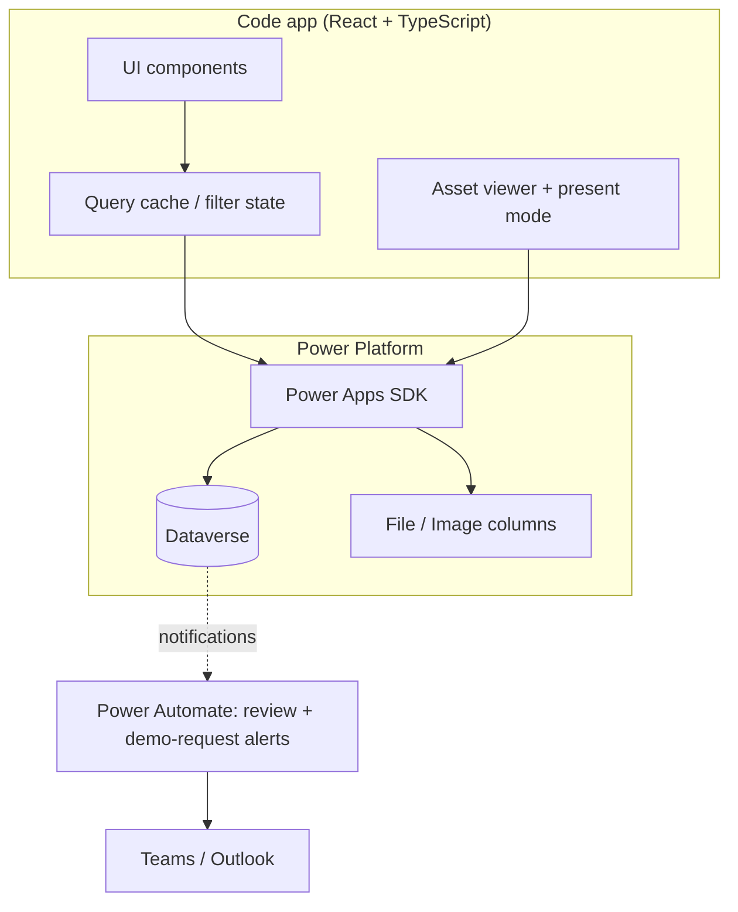

# Technical architecture

**Status:** Living; broad cross-area review reading deployed to dev on 2026-10-27 with signed plug-in/app upload and privileged API checks verified; hosted refresh/authentication and non-admin acceptance remain pending. Production remains on managed release 1.0.0.4 with uploaded-file display names and Markdown. Full Markdown round-trip/export verification, broader recipient coverage and private-endpoint foundation remain open · **Last updated:** 2026-10-27
**Source:** [End-to-end design §7](../design/end-to-end-design.md#7-technical-architecture)

**Authorization status (2026-10-26):** Capability-owner SA scope, compatible connected app and separately approved role migration deployed; five owners and Luis's global override provisioned; remaining owner onboarding and least-privilege acceptance pending. [ADR-0013 amendment](decisions/adr-0013-librarian-content-editing.md#capability-owner-scope-2026-10-26) replaces unscoped librarian checks with `LibrarianAccess` across review, editing and media. Queue queries join the main capability and filter authorized SAs before paging; detail flags are solution-specific. Scoped operations use server rights after authorization rather than requiring organization-wide table privileges. Media snapshots add optional `solutionId`; `nx_ReadVideoRange` accepts `Mode=image` for bounded PNG/JPEG image and thumbnail reads, including non-chunkable Dataverse images up to the existing 20 MiB limit. Attachment modes and present-mode checks are unchanged. The API returns bytes and pinned versions, never storage credentials. The compatible connected client was deployed before the [preview-first role migration](security-model.md#capability-owner-librarian-access); no new Custom API or schema component was required. The security model records installed assembly verification, app bundle, media-share migration and privileged read evidence.

### Cross-area review rollout (2026-10-27, dev only)

The user explicitly approved Juliana's broader policy, including active Pending review, Published, Changes requested and private suggestions across areas, superseding the earlier Pending-only recommendation. [ADR-0013](decisions/adr-0013-librarian-content-editing.md#read-across-areas-approved-2026-10-27) owns the contract. Integrated main through `cc83287` (including `9554365` and the My capability wording), then committed/pushed `6857ad4`: reject inactive cross-area records, omit unfinished media from view-only detail, add file/revocation/state regressions and keep the three-way selector within mobile bounds. Decisions, edits, uploads and editor/checkpoint reads still require management/owner access.

Verification on the adopted implementation: 162 backend tests, 111 connected tests and 67 rendered UI tests passed, with lint, test type-check and both app builds. The existing bundle-size warnings remain. Local browser fixtures verified all three cross-area tabs, own-area filtering, no decision/edit actions on external detail in all three states, and mobile 320px/dark plus desktop/light rendering. These were synthetic adapters, not non-admin Dataverse acceptance; no user solutions were changed.

From synchronized `origin/main` `6857ad4`, built clean Release and signed with existing certificate `7C1DE36FE41E9376A7F5998ED59E748DBABD48A2` (expected self-signed-root warning). `Prisma.Deploy blob-plugin` preview and execute verified Nextant Pulse `cd98dcb3-db3b-f011-be51-00224820bb36`. Assembly `08207a52-1ab6-f111-aaac-6045bd049fba` was updated at `18:58:51Z`; readback matched SHA-256 `75E4216C7FDB43A256392264B86CA9253A7D0C9C95F2EF5968574CC4F9322340` and retained managed-identity binding `eeac4d3a-1cbc-f111-aaae-6045bd049fba`. Existing Blob deletion registrations were reapplied; no new API, schema, role or infrastructure changes were made.

Immediately published connected app `cffbecd7-c927-474e-b6ed-6c7957ec74cb` into `PRISMA_Dev` with explicit solution ID. Upload succeeded with `sourcetime=1793127562490`, bundle `index-45tcUHmX.js`. Read-only calls as global librarian Luis verified eight queue records with `manage=true`, detail without view-only permissions, 1,024 protected image bytes and readable suggestions. The existing hosted tab remained at the platform's old-version refresh banner with a blank app frame; a new tab redirected to Microsoft sign-in. Therefore hosted execution of the new bundle and actual area-librarian cross-account acceptance are not claimed. Refresh/sign in, then verify both area and global workflows. No business records were created or changed; production and the separately published PoC were not deployed.

The earlier scope-metadata-only dev deployment from `51091fe` was verified at `18:08:24Z` with SHA-256 `7DABDFCBD09DD08A2EA10436A3C81FCEB7F4E5087993426DAA44A1074F1CB68C`; its global hosted queue check passed before this broader rollout. It is superseded by the assembly above, not evidence that the new hosted bundle was tested.

**Confirmed stack:** Power Platform code app (React + TypeScript) over Dataverse, Microsoft Entra ID SSO, internal Nextant users only, Nextant brand standards.

## Environment and solution

The Power Platform solution **`PRISMA_Dev`** exists in **Nextant Pulse**, environment ID **`ce09ad9b-57d1-e5df-9400-8ce973c86213`** (not Nextant Pulse Prod). In the Power Apps maker portal, select that environment and open **Solutions > PRISMA_Dev**.

This Power Platform solution is distinct from both the published code app **PRISMA PoC** and the catalogue's `nx_solution` records. PAC CLI inspection on 2026-09-21 confirmed unmanaged solution version `1.0.0.1`, solution ID `adddc940-98ff-4b2f-9c8a-e89245c2fc33`, publisher `nx`, customization prefix `nx`, and choice-value prefix `12506`. The Dataverse URL is `https://nextantpulse.crm.dynamics.com/`.

The initial 2026-09-21 export included **PRISMA PoC** (`cr6b0_prismapoc_c440f`, CodeApp type 4); `pac code list` returned only the existing PoC app. Its connection/database references were empty. App IDs, publishing commands and verification status are maintained in the [deployment details](../../app/README.md#poc-deployment). No connected PRISMA app was published during that initial inspection.

### Production deployment preflight

**Status:** Production imported and launched; 84 references, named-user access, group contributor field security/group-backed published readers and separately approved group CanView app share configured. Scoped workflow/media and reader-principal checks passed; Blob uploads enabled. Four licensing exceptions and actual non-admin acceptance remain open. **Last updated:** 2026-10-26.

Approved preparation scope: connected PRISMA plus backend and reference data, **no existing submissions or attachments**, using the same Blob account with a separate production container. The user subsequently approved release-solution creation, Azure provisioning, production identity/backup/import, and finally committing/pushing the filename fix, republishing dev and retrying production. Only the approved build configuration was committed (`9f08d5b`); other local preparation edits were preserved. Dev Blob trust and environment-variable values were not changed.

| Target | Verified value |
|---|---|
| Production environment | Nextant Pulse Prod, `bce2c94a-b2b3-e487-b368-b8d7c931f90b` |
| Dataverse URL / organization ID | `https://org08fa4839.crm.dynamics.com/` / `b3aa4d34-8957-f011-8ee3-7c1e52172903` |
| Installed production solution | `PRISMA_Release`, managed `1.0.0.4`, ID `63184600-1271-42ba-85a4-ff46053bbd67` |
| Production app | `57f5ef47-d997-4323-a8b8-0c4bf6a9a529`; [open PRISMA in production](https://apps.powerapps.com/play/e/bce2c94a-b2b3-e487-b368-b8d7c931f90b/app/57f5ef47-d997-4323-a8b8-0c4bf6a9a529?tenantId=d232b207-f86f-4fba-8891-ccbf30b12898) |
| Existing storage account | `stprismamediaiwguqp7gvh`, resource group `RG-Prisma-Media-DEV`, subscription `f997a88d-a154-449c-8e29-5518ffe24c02` |
| Deployed production container / identity | `media-prod` / `id-prisma-media-plugin-prod` |
| Production identity client / principal | `e23344b9-5f16-4004-bc86-0c908205ea52` / `299331d2-848d-4b55-b11f-72801fca98eb` |
| Initial production Blob settings | `nx_MediaBlobContainerUrl=https://stprismamediaiwguqp7gvh.blob.core.windows.net/media-prod`; `nx_MediaBlobUploads=no` |
| Current production upload setting | `nx_MediaBlobUploads=yes`, retained after the approved acceptance and cleanup checks below |

The initial `pac solution list` found no PRISMA solution in production. A managed export of live `PRISMA_Dev` version `1.0.0.1` was saved as `$env:TEMP/PRISMA_Dev_managed_preflight_20261026.zip`. **This is an inspection artifact, not an approved production release.** It contains both PRISMA and PRISMA PoC, 15 table definitions, five security roles, four field-security profiles, one plug-in assembly, 26 registered steps, 24 Custom APIs, two Blob environment-variable definitions and the dev managed-identity record. Its 88 dependency entries include 22 distinct tables; all 22 exist in production. Column, relationship, form and other component/version compatibility remain unverified. Full shared Consultant/Project customizations must not be imported without review.

The generated local `$env:TEMP/PRISMA_Prod_preflight_20261026.settings.json` contains the production Blob settings above. It has **no standard connection references**. The exported code app instead contains an Office 365 Users reference and an environment-relative `default.cds` Dataverse reference. An Office 365 Users connection is available to the current account in production, but code-app connection mapping, consent and target-only Dataverse access must still be verified after import. Do not treat the empty standard connection-reference array as proof that connector setup is unnecessary.

**Connected-only release (2026-10-26):** created unmanaged `PRISMA_Release` (`1da6ffed-57d1-f111-a059-002248040303`) in dev with the existing publisher (`ab4abd97-8dc8-4f71-b7b9-78333094d3de`). Added existing components without automatic required-component inclusion. Dev current-value records were removed from **release membership only**, and their unchanged values were read back. Exported `$env:TEMP/PRISMA_Release_managed_20261026.zip`, version `1.0.0.1`, SHA-256 `FA90843C67029853F6926D00309F3F4B1EE9F46960D4B63594139B2489507C5D`. This initial artifact was superseded by the successful retry recorded below. The settings file remains `$env:TEMP/PRISMA_Release_prod_20261026.settings.json`, validated with `media-prod` and uploads `no`.

The release contains one connected app (`nx_prisma_784d1`, exported app version `2026-10-26T15:28:30Z`), 13 PRISMA-owned tables, 24 Custom APIs, 26 plug-in steps, five roles, four field-security profiles and two environment-variable definitions. It excludes the PoC, full Consultant/Project table definitions, dev current values and the dev managed-identity record. All eight declared dependency entries resolve to three distinct requirements verified in production: `cr6b0_consultant`, `cr6b0_project` and `cr6b0_consultant.cr6b0_consultantname` (String). The exported assembly's signer matches the approved certificate; Authenticode reports the expected untrusted-root chain warning, not a trusted production certificate. No app or plug-in rebuild/push was performed: the package carries the deployed source components.

**Release refresh after Juliana's changes (2026-10-26, historical):** the initial release ZIP was superseded by `$env:TEMP/PRISMA_Release_managed_20261026_6153f03.zip`, SHA-256 `E4DDC82867ACF9840F533A079E581F511A1F52DADF83A6DAC670900F396A1392`. Main was fast-forwarded through Juliana's four commits to `6153f03`: list-row styling, submission thumbnails and Help content/tests only; no backend or deployment-config changes. All 58 rendered UI tests, test type-check and connected production build passed (existing bundle-size warning remains). The exported app version was `2026-10-26T16:49:24Z`; all 14 packaged JavaScript/CSS files matched that local build byte-for-byte. The plug-in DLL was byte-identical to the initial approved-certificate export. This package retained one connected app, 13 PRISMA tables, 24 APIs and eight dependency entries, with no environment-variable value files. Import was paused at that stage, then approved and attempted as recorded below; this package is now superseded by the successful URI-safe release.

**Identity import prerequisite (completed with approval):** the assembly XML references `ManagedIdentityId=eeac4d3a-1cbc-f111-aaae-6045bd049fba`, despite not exporting that record or declaring it in the missing-dependency list. Created that component ID **in production only**, with production client ID `e23344b9-5f16-4004-bc86-0c908205ea52`, tenant `d232b207-f86f-4fba-8891-ccbf30b12898`, `credentialsource=2`, `subjectscope=1`, `version=2`; all values were read back. The record survived the failed import and the successfully imported assembly now references it. Do not change the source binding or use the dev Azure identity. Subsequent runtime storage access was verified in the production activation below.

**Approved import attempt (2026-10-26):** the user approved identity setup, recovery-point verification, managed import with uploads disabled, and app/backend verification. `pac admin list-backups` initially returned none. Created and verified manual backup `627c3f99-ac0d-4929-9d1b-c2d23dc2caaf`, label `PRISMA pre-import 2026-10-26 6153f03`, point `2026-10-26 17:00:44`, expiry `2026-11-02 17:00:44` as reported by PAC. Restoring this environment-wide backup requires separate approval and coordination; do not restore automatically.

Imported the reviewed `6153f03` package with the final production settings, `--activate-plugins --async --max-async-wait-time 60`, without force-overwrite, dependency skipping or environment-wide publish. Operation `e3442506-5fd1-f111-a059-0022481cc95e` failed after about 11 minutes; import job `48f978ec-07b6-4b11-93b5-a50258fd369c` ran from `17:03:03Z` to `17:14:06Z`. Error: `CanvasApp import: FAILURE: Part URI is not valid per rules defined in the Open Packaging Conventions specification.` Readback confirmed no `PRISMA_Release` solution, connected PRISMA app, `Prisma.Plugins` assembly or any of the 13 PRISMA table definitions remained. No reference data, submissions, attachments or user assignments were copied. The production identity and Azure resources were created separately and remain intact.

**Packaging fix, deployed with approval:** the failed export's only unusual asset path was `CanvasApps/nx_prisma_784d1_CodeAppPackages/assets/PRISMA%20Demo-web-DUZPrx3T.mp4`. The full ZIP and encoded URI pass local OPC validation, but the decoded path with a literal space reproduces the exact error under `PackUriHelper.GetNormalizedPartUri`. [Connected Vite configuration](../../app/connected/vite.config.ts) now emits hash-only filenames for assets whose names contain characters outside `A-Za-z0-9._-`, preserving the default naming for other assets. The build emits `DUZPrx3T.mp4`, with unchanged video SHA-256 and an updated compiled reference. All 49 output file paths pass strict OPC validation; connected build, file lint and editor diagnostics pass. Committed and pushed only this fix as `9f08d5b`, rebuilt, then published the existing dev app in `PRISMA_Dev` (returned `sourcetime=1793035312220`, entry `index-CyWH85IZ.js`). No ZIP hand-edit, backend update or PoC publication was needed.

**Successful production retry (2026-10-26):** the authoritative artifact is `$env:TEMP/PRISMA_Release_managed_20261026_9f08d5b.zip`, SHA-256 `12A22BA2E5376028D1EDC745BECA5B36B6E7C14F48B549DE5C46069525E9803A`, superseding both earlier release ZIPs. Source app version `2026-10-26T17:21:52Z`; all 49 exported app files match the committed build byte-for-byte and decoded paths pass strict OPC validation. The plug-in is byte-identical to the previously reviewed signed assembly. Normal dependency checks remained enabled, with no force-overwrite or environment-wide publish. Import operation `9c565e37-62d1-f111-a059-0022481cc95e` succeeded in about 14 minutes 41 seconds; import job `096bc4a6-921c-4f5a-8236-31bb85f88ee3` reached 100%, from `17:25:41Z` to `17:39:37Z`.

Initial production readback verified the managed solution and app IDs above (target app version `2026-10-26T17:32:11Z`), exact approved plug-in binary SHA-256, production managed-identity binding, 26 enabled steps, 24 Custom APIs, and initial values `nx_MediaBlobContainerUrl=.../media-prod`, `nx_MediaBlobUploads=no`. Read-only `nx_GetCatalogueGraph` calls succeeded with both `Present=false` and `Present=true`, returning the empty-catalogue contract. Solutions, contributors, demo assets, images, upload sessions and all five reference tables each contained zero rows, confirming that solution import did not copy their data. At that stage the browser stopped at sign-in and no user/team assignments, reference seeding, media test writes or upload enablement had occurred; subsequent setup and acceptance are recorded below.

The additive [production-container.bicep](../../infra/media/production-container.bicep) declares the existing account/service as `existing`, a private `media-prod` container, a separate production identity and Blob Data Contributor on that container only. It does not alter account networking, keys, retention, logging, dev resources or existing data. **Use incremental mode only.** Shared account capacity, billing and account-level policy remain shared; container isolation is not account-level isolation.

Local infrastructure assertions passed. Azure what-if in the verified subscription/resource group succeeded with **three creates, zero updates and zero deletes**, with `owner=lpreciado@nextant.com`, `location=eastus` and an empty federation subject. Existing resources were ignored. This is a storage-only preview: an empty `pluginFederatedSubject` creates no trust and cannot enable plug-in access. Rerun what-if with the final certificate-derived production subject before approving deployment.

After the user's self-signed exception, the full what-if was rerun on 2026-10-26 with the existing certificate's verified SHA-256 hash and the production environment ID. It succeeded with **four creates, zero updates and zero deletes**, adding `nextant-pulse-prod-plugin` federation to the three resources above. The subject is `/eid1/c/pub/t/B7Iy0m_4uk-Ikcy_MLEomA/a/qzXoWDkuqUa3l6zM5mM0Rw/n/plugin/e/bce2c94a-b2b3-e487-b368-b8d7c931f90b/h/ba2870bd17bbb03a4e9af85d97b41a7efb2f491cb43f9916d8555fe46cd188e2`.

**Azure execution (2026-10-26, explicitly approved):** incremental deployment `prisma-production-container-20261026` succeeded. Readback confirmed the private `media-prod` container, production federation subject/audience/issuer and Blob Data Contributor for principal `299331d2-848d-4b55-b11f-72801fca98eb` scoped to that container only. Dataverse binding was verified following import; actual token-mediated upload, read and deletion were verified later in the activation checks below, not inferred from provisioning alone.

**Production activation and acceptance (2026-10-26):** after the user enabled Code apps, signed-in launch and the empty library passed. The user then approved the current reference seed, Luis-only contributor/reader/global-librarian access, disposable tests, and permanent Blob uploads only after passing tests. The [reference-data record](../data_model/reference-data-governance.md#production-reference-seed-2026-10-26) owns the 84-row seed and exact owner mapping; the [security model](security-model.md#production-access-2026-10-26) owns the two runtime teams, additive access and separately approved four-source CSP change. Dev data/configuration remained unchanged in this setup pass; no production app or plug-in republish was needed.

[production-acceptance.ps1](../../tools/production-acceptance.ps1) is guarded for the exact production organization, approved Luis identity and `media-prod` container. `-Phase Inspect` is read-only. Its approved `Create` run used only PRISMA Custom APIs for one labelled synthetic solution, contributor graph, image and attachments; it restored uploads to `no` on failure. Fixture `cefc4627-6ad1-f111-a059-7ced8dd5db8b` completed create/save, submit, return with feedback, resubmit and approve. The image stayed in Dataverse; HTML, PDF and 50 MiB MP4 selected Blob storage. Every protected read matched its source SHA-256. The resumable video checkpoint matched the first confirmed block, wrong-file resume was denied, and draft-present/stale-version reads were denied. Published present-mode responses excluded `INTERNAL-PROD-ACCEPTANCE-ONLY`.

Hosted checks used the actual production app as Luis: correct bundle and seeded capability/owner, 640x360 image, normal-mode internal marker and present-mode redaction; interactive HTML returned `Approved sample` under `sandbox="allow-scripts"`, with parent document and storage access denied. The PDF Download action produced the exact 974-byte source hash `1975ac6190c43435356787c3aa392ad8bd90951de77d153a94712e2383a90f78`. The integrated browser's progressive MP4 path offered its fallback; **Load full video** delivered 52,428,800 exact bytes (SHA-256 `48f8a871e7a615d9a23deba06cd419465c24be4dd5128365061865412cb7ebd3`), decoded 1920x1080/60 seconds, sought to 20 seconds and advanced playback. A deferred compositor callback confirmed a nonblank frame at 20.866667 seconds (1,133 sampled colors, no media error). The generic screenshot did not paint the embedded app and is not visual evidence. Full-video fallback is verified; progressive AAC playback, sustained full-duration/audio playback and OS-level file saving are not claimed.

`-Phase Cleanup -KeepUploadsEnabled` withdrew the fixture, confirmed published-detail and each attachment's present-mode reads were denied, then deleted it through the controlled transition. Readback found no parent, contributors, images, assets or sessions and no remaining Blob-deletion jobs. The existing Log Analytics workspace `36a4ce03-059c-41a0-94f9-db98fa73b1b0` recorded all three `PutBlockList` operations (201) and exact-path `DeleteBlob` operations (202, at `18:31:49Z`) under production plug-in principal `299331d2-848d-4b55-b11f-72801fca98eb`, OAuth. Direct Blob listing by the operator was denied; no storage keys or extra operator data-plane grants were used. Existing soft-delete retention remains unchanged. All browser probes were removed, and the app was left in normal mode with an empty library and review queue. Reference-data repeat preview still proposed zero changes.

Final readback: **production Blob uploads remain `yes`** as approved after passing the scoped tests. Only the synthetic fixture was deleted; no dev solutions or attachments were migrated. The API lifecycle and selected hosted views were tested, not a complete keyboard-driven submission wizard. Because Luis retains preexisting administrator access, these results do not establish non-admin ownership, cross-SA denial or cross-account review. Other users still require approved onboarding, app sharing/licensing and baseline Consultant/Project access; browser compression, PowerPoint/WebM and broader browser/mobile acceptance remain separate gates.

**Additional user onboarding (2026-10-26):** the user subsequently approved Juliana as a contributor and all 13 active capability owners as scoped librarians. Their PRISMA role/profile/Published Readers assignments and CanView sharing of the production app were applied and read back; all already had the existing baseline roles. The [security record](security-model.md#additional-production-recipients-2026-10-26) owns the recipient list, scope and preserved preexisting privileges. No notification emails, co-owner/global grants or licence changes were made. First sign-in and cross-account behavior still need recipient testing.

**Group contributor setup without app sharing (2026-10-26):** added the Contributor field-security profile to Nextant Consulting - ALL and switched the publication target to the new Members-only group team `74dd1768-3a75-4348-aced-20e9eb752f6d`. The original reader owner team was retained as Initial Pilot, with its 15 memberships and role preserved; no production solutions existed at migration. Exact publication/revocation rights and fixture cleanup passed. The [security record](security-model.md#group-backed-published-access-2026-10-26) owns the migration, 143 confirmed Premium-plan members out of 147 enabled members, four entitlement exceptions and unchanged app-sharing fingerprint. No app sharing, licence allocation, directory membership, account enablement, app publish or plug-in deployment was performed in this step.

**Group app sharing subsequently approved (2026-10-26):** the user explicitly lifted the earlier exclusion. Added CanView for Nextant Consulting - ALL to the production app, verified the exact group/environment/app IDs and preserved all 15 individual permissions; final count is 16. No notification emails, co-owner/global grants, licence changes or employee-data edits were made. The [security record](security-model.md#approved-production-group-app-share-2026-10-26) owns the grant and remaining licensing/directory/sign-in caveats.

**Classification-save permission correction (2026-10-26):** Juliana's non-admin test exposed a missing N:N association prerequisite: Contributor/Librarian roles had Append To but not Append on the five PRISMA reference tables. With separate user approval, added only those five Global Append privileges per role in dev and production, preserving existing rights and the read-only CSM role. The local provisioning rule now includes Append; its build passed. Juliana's effective record access was verified and her draft version remained unchanged. Her browser retry is still required; the [security record](security-model.md#classification-association-privilege-correction-2026-10-26) documents evidence and safe recovery. No app/backend push was performed, and future managed releases must be freshly exported to include the corrected source roles.

**Contributor save fix deployed (2026-10-26):** after the separately approved reference Append repair, exception-only tracing captured a duplicate solution/person contributor key on Juliana's context-step save. Tracing was restored to Off. Commit `c5c03eb` contains the reference-role provisioning correction and a parent-local contributor re-selection fix, with a reproduced-then-passing regression, 20 passing classification tests and 147 passing Release backend tests. The signed dev assembly was updated through `Prisma.Deploy blob-plugin` after its read-only preview; no app files changed.

The current managed artifact is `$env:TEMP/PRISMA_Release_managed_1_0_0_2_c5c03eb.zip`, SHA-256 `C47473BB3976CD4ABD3E0AEBE8BAC81AC1423C75CBF810109125A3BC52B1765F`, superseding the earlier `1.0.0.1` packages. All 49 app files matched the previous release. Both reference-role corrections were verified in the package. Backup `d170d336-c38b-4935-8b78-0f990bf9f206` (label `PRISMA contributor fix c5c03eb 2026-10-26`) was created and read back before import. Import operation `93b20f37-7dd1-f111-a05b-002248303b49` succeeded in about 2 minutes 25 seconds, with normal dependency checks and no force-overwrite. The new settings file `$env:TEMP/PRISMA_Release_1_0_0_2_prod.settings.json` explicitly preserved `media-prod` and `nx_MediaBlobUploads=yes`.

Production readback confirmed managed version `1.0.0.2`, the unchanged app ID (target app version `2026-10-26T20:40:35Z`), exact signed plug-in SHA-256 `0B050729C32E0AF4EEA0B3DB741396F057764019BF0623D1B8BA8F127DC7CC54`, the existing production identity binding, uploads enabled and tracing Off. Disposable regression draft `0f2559b1-7dd1-f111-a05b-0022481ccc38` saved the same contributor twice without its prior row ID; the API retained credit `929559b4-7dd1-f111-a05b-6045bddb373c`, advanced the version and left exactly one credit. The fixture and credit were removed through the controlled API. Juliana's real draft was not used for the probe, and the user subsequently confirmed that she could continue to Media. This confirms the reported blocker is resolved, not completion of every non-admin workflow/media acceptance gate.

**Markdown release deployed (2026-10-26):** commit `428f4f9` added the four-field Markdown editor, safe shared renderer and parsed plain-text search/deck output. Both builds, 61 rendered UI tests, 53 shared unit tests, 105 connected tests, test type-check and lint passed; runtime dependency audit reported no vulnerabilities. The connected dev app was published with unchanged IDs (`sourcetime=1793049313018`, source app version `2026-10-26T21:15:12Z`, bundle `index-BgCoIXww.js`). No plug-in upload or separate PoC publication was performed.

The Markdown artifact was `$env:TEMP/PRISMA_Release_managed_1_0_0_3_428f4f9.zip`, SHA-256 `3576C5ACF96526DB3FC31E0E99E75F475F0914AD0A6184829751C85FCE7CD436`, superseding the earlier release packages. All 49 exported app files matched the committed build and passed decoded package-URI checks; the plug-in binary and role privileges matched `1.0.0.2`. Backup `69363f0b-796b-4363-9b59-cd98af9963ce` (`PRISMA Markdown 428f4f9 2026-10-26`) was created and verified. Import operation `a15494ec-82d1-f111-a059-7ced8dd524dd` succeeded in about 3 minutes 51 seconds, using `$env:TEMP/PRISMA_Release_1_0_0_3_prod.settings.json` to preserve `media-prod` and `nx_MediaBlobUploads=yes`, with no force-overwrite or dependency skipping.

Production readback verified managed `1.0.0.3`, the unchanged app ID (app version `2026-10-26T21:22:39Z`), unchanged plug-in SHA-256 and managed-identity binding, and unchanged Blob settings. All 16 app permissions were preserved, with pre/post fingerprint `23F100C229FE9640C7E1A6EED09B0AB9C454D0EA3C734B4E9DBB689DC9BC7E71`. Fresh hosted dev and production pages served `index-BgCoIXww.js`; production first required the host's Refresh banner. In both apps an unsaved form rendered bold text and a two-item Markdown list in Preview while retaining the raw source and 4000-character limit. The temporary edits were discarded using the normal confirmation flow, and no draft was saved. This verifies hosted authoring/preview, not a stored Markdown round-trip or visual PowerPoint export. Existing user drafts were not edited.

**Uploaded-file display names deployed (2026-10-26):** commit `f9eacbb` added the [display-name workflow](../workflows/demo-assets.md#display-names), preserving original download filenames and upload identities. Both builds, test type-check, lint, 55 focused shared/connected tests, 62 rendered UI tests and 69 backend policy/snapshot tests passed. The signed Release assembly was deployed through `Prisma.Deploy blob-plugin`, followed by the connected dev app with unchanged IDs (`sourcetime=1793050730283`, app version `2026-10-26T21:38:50Z`). The deployed assembly hash and existing managed-identity binding were verified. The separate PoC code app was not republished.

The current managed artifact is `$env:TEMP/PRISMA_Release_managed_1_0_0_4_f9eacbb.zip`, SHA-256 `41AD1045AD2EA33C804E6CF7C6807B5F8865F18317B8C51EB1AB1A6B0B5057F3`. All 49 exported app files matched the committed build, and the packaged signed plug-in SHA-256 is `5ECB2D5025BC7E61F59A79FD59A52007EE8C0E68CDF55BA71C8781190A5520A6`. Root components, dependencies, role privileges, field security, table schema, relationships and organization settings matched `1.0.0.3`; package URI checks passed and the package still excludes the PoC, dev current-value records and managed-identity records.

Backup `e432ba24-fc26-457d-8eb8-4b064dc22dda` (`PRISMA display names f9eacbb 2026-10-26`) was created and verified. Import `aec21276-86d1-f111-a05b-3833c5ec7e2d` succeeded in 2 minutes 41 seconds, with plug-in activation and no force-overwrite, dependency skipping or environment-wide publish. Explicit deployment settings retained `media-prod` and `nx_MediaBlobUploads=yes`. Production readback confirmed managed `1.0.0.4`, app version `2026-10-26T21:47:04Z`, the exact signed assembly, unchanged production identity properties/binding and all 16 app permissions (pre/post fingerprint `980FA328E8A32AFC928CA27E28E0CB8BDE5341DFF0D4191E894A4F9694049AEC`).

In both environments a disposable caller-owned draft uploaded a synthetic HTML file, saved a display name, reopened it and verified the title in Dataverse and the media API. Original filename, upload session and downloaded bytes were unchanged. Fixtures `6f9bb559-86d1-f111-a059-002248040303` (dev) and `058bf4ea-86d1-f111-a05b-0022481ccc38` (production) were deleted through the controlled API; parent and upload-session absence were verified. Direct inspection of asynchronous Blob deletion was blocked by the current account's Blob data permissions; no keys, role changes or permission workarounds were used. Both hosted apps served `index-B5u0bQEz.js` after using the host's Refresh action; production reported Catalogue ready without app alerts. These checks do not certify non-admin behavior, a complete hosted rename interaction or visual PowerPoint export, and no existing user drafts were edited.

**Review-queue scope and UI polish deployed to dev (2026-10-27):** the connected dev app was published six times from `main` with unchanged IDs and `--solution-id`: `684097b` (library Refresh, hover on every button, present switch limited to the library, solution and saved-solution pages, My submissions attention copy, possible-duplicate technology decisions through the existing librarian graph save of [ADR-0013](decisions/adr-0013-librarian-content-editing.md), area-librarian Review queue layout, no reference-data error flash when opening a submission), `16f1dbd`, `c678b43` and `ee100a8` (duplicate-technology fixes, My submissions card click), `51091fe` (visible hover tint, missing-field hints in the submission form, busy overlay during saves) and `bd94aaa` (Capability filter lists only capabilities with submissions in the open tab). The last push returned `sourcetime=1793124485746`. At `bd94aaa`, both builds, lint, test type-check, 54 shared, 111 connected and 65 rendered UI tests passed. The [librarian runbook](../operations/librarian-runbook.md#connected-prisma) describes the queue behaviour.

`684097b` also changed the plug-ins: `nx_GetSubmissions` with `ReviewQueue=true` returns an optional `scope` (`global`, `areaIds`, owned `capabilityIds`) from `LibrarianAccess.Scope()`, used only for the queue's filters and never for authorization. There is no schema, Custom API, registration or role change, and 149 backend tests passed. Luis deployed the signed assembly to dev on 2026-10-27, as reported by Juliana. The source commit, assembly hash and identity binding of that push were not recorded here. Without `scope`, the app keeps the global layout. Production stays on managed `1.0.0.4`; none of these changes are in it. Hosted verification of the area-librarian layout and the other changes is pending.

Release decisions and remaining gates:

1. The user explicitly approved using the existing self-signed `CN=PRISMA Plugin Signing Dev` certificate on 2026-10-26 (thumbprint `7C1DE36FE41E9376A7F5998ED59E748DBABD48A2`, expires 2028-09-29; private key available locally and not exported). This is a deployment exception to [Microsoft's managed-identity guidance](https://learn.microsoft.com/en-us/power-platform/admin/set-up-managed-identity), which limits self-signed certificates to development/testing, not evidence of production compliance. Use a separate production identity and an environment-specific v2 certificate-hash subject; preserve the dev trust. Shared certificate ownership and renewal remain an operational risk. This exception does not itself authorize solution creation, Azure provisioning or production import.
2. Connected-only release creation and export are complete as recorded above. Do not hand-edit the export ZIP or overwrite the dev app configuration. Refresh and reverify the artifact if source components change before import.
3. Azure provisioning, production identity setup and imported assembly binding are verified. Client ID `ed62de8f-c17f-4d6b-b7b4-62f90898f18f` remains dev-only. Do not bypass the dev organization guards in `Prisma.Deploy`.
4. Managed import, reference seeding, runtime teams and approved access for Luis, Juliana and all 13 capability owners are complete. Do not copy submissions, upload sessions, favourites, Consultant/Project records or attachments. Any further users need an approved membership list; reference ownership and installed roles do not automatically grant memberships.
5. Code-app enablement, the approved [hosting CSP](security-model.md#code-app-hosting-policy), protected media checks and cleanup are verified. Production uploads are enabled. Any additional environment-wide policy change requires separate review.
6. Retain the acceptance limits above. Complete non-admin/cross-account authorization, full wizard, broader media/browser coverage and other-user sharing/licensing before claiming general-release acceptance.

### Verified solution inventory

Evidence: `pac solution list`, FetchXML queries through `pac env fetch`, and an unmanaged `pac solution export` inspected as XML. The following is the initial read-only snapshot from 2026-09-21, before the approved core-draft deployment below; its zero counts and absent components are historical. The temporary export includes the PoC package and is not a schema-only artifact to commit.

| Live logical table | Rows visible to inspection caller | UI mapping / integration note |
|---|---:|---|
| `nx_solution` | 0 | Core catalogue; current narrative columns are `nx_solutionname`, `nx_onelinesummary`, `nx_whatitdoes`, `nx_businessvalue`; specialization and capability are lookups, not string enums/N:N capability tags |
| `nx_solutioncontributor` | 0 | `nx_builtby` references `cr6b0_consultant`; minimum hours in `nx_directhours`; date/allocation columns retired, unused |
| `nx_solutionimage` | 0 | Gallery image column `nx_imagefile`, caption and sort order |
| `nx_demoasset` | 0 | File column `nx_filemedia`, asset choice, external URL and embedding fields; name column is `nx_demoassetid1` |
| `nx_demorequest` | 1 | Requester references Consultant; do not delete or replace the existing row when seeding |
| `nx_specializationarea` | 3 | Resolve Dataverse IDs to UI area keys explicitly |
| `nx_capability` | 2 | Single capability lookup per Solution |
| `nx_technology` | 8 | Native N:N with Solution |
| `nx_industry` | 4 | Native N:N with Solution |
| `cr6b0_consultant` | Not queried | Reused people directory; fetch only name/email/ID and agreed eligibility fields |
| `cr6b0_project` | Not queried | Reused delivery evidence; native N:N with Solution; preserve existing security and schema |

The export has 11 table definitions; the solution-component query reports 14 Entity components, including relationship infrastructure. Native N:N definitions include `nx_Solution_nx_Technology_nx_Technology`, `nx_Solution_nx_Industry_nx_Industry` and `nx_Solution_cr6b0_Project_cr6b0_Project`. Do not implement the PoC's historical `nx_solutionproject` junction model.

The **PRISMA Librarian** field-security profile grants read/create/update for `nx_publicationstatus`, `nx_clientsafereviewed` and `nx_librarynote`. This is not a table security role or proof of user membership. Review Outcome/Comments are present in the schema but absent from that profile's exported permissions. No security-role, plug-in or Custom API components were found in this solution. The export also carries two existing Project business rules, not PRISMA transition handlers. Environment-wide components and effective permissions require separate verification; absence from this solution is not proof of absence from the environment.

### Live-schema gaps to resolve

- All 11 exported tables are **UserOwned**, including the four reference tables and Consultant. The design's organization-owned assumption is not the deployed model. Prefer explicit organization-level reference Read privileges with controlled writes; do not recreate tables or change existing Consultant/Project security without approval.
- Review Outcome/Comments were unsecured in the initial inventory. The approved core-draft deployment secured both and created unassigned read profiles; effective non-admin permissions remain unverified. Publication status, clearance and Library Notes were already secured.
- Capability was ApplicationRequired; deployment made it optional for Draft. Submit/approve enforce completeness. Product limits are name 100; summary/internal and redacted context 200; what-it-does/business-value 4000. Live name metadata remains 850. Generated max lengths are not product limits.
- Publication and maturity choices have no configured default (`AppDefaultValue=-1`); creation must supply the agreed state. Publication values are Published `125060000`, Retired `125060001`, Pending review `125060002`, Draft `125060003`. Maturity values are Live in production `125060000`, Idea / concept `125060001`, Client demo `125060002`, Retired `125060003`, Working prototype `125060004`.
- Child-to-parent relationships currently use `NoCascade` for Assign/Share/Unshare and `RemoveLink` for Delete. A parent lookup does not propagate access or guarantee child cleanup. Define and enforce ownership, sharing/revocation and deletion for every child and file.

Track decisions and required owners in the [decision log](../delivery/decision-log.md). These observations do not authorize changes to shared environment security or destructive table recreation.

### Story-column retirement

The approved 2026-09-22 model retains only What It Does and Business Value in the story section. The app, search, draft/recovery contracts, plug-in responses and generated schema no longer reference the retired column. Older recovery payloads discard it rather than restoring it.

Live preflight found one populated value and one isolated row on the Solution Information form. The user approved publishing the current connected app (including existing profile-photo changes), updating the existing plug-in, removing that form row and permanently deleting the column. All steps completed in Nextant Pulse; repeated metadata reads confirm absence in published/editable definitions, and form readback retains every other control. Hosted creation/save/reopen of both narrative values passed; disposable draft `ca8e071a-c2b6-f111-aaac-6045bd049fba` was deleted. Existing published search/detail, present-mode redaction, images/fonts and interactive HTML passed. Package and test results are recorded in the [deployment record](../../app/README.md#pilot-deployment-2026-09-22).

`Prisma.Deploy remove-story-field` is read-only by default; `--execute` checks the organization, exact column/form IDs, editable XML and dependencies, publishes only `nx_solution`, and verifies absence in published/editable metadata. It refuses unrelated dependencies or more populated records than approved; subsequent previews are no-ops. Other columns, existing records, roles, CSP and the PoC deployment are unchanged. Existing app tabs must refresh after rollout. The earlier hosted lifecycle narrative revision was in the now-retired field; that historical check does not imply its value was migrated into either remaining narrative.

## Connected-app integration plan

Keep **PRISMA PoC** as the live UI test app. Create **PRISMA** with a separate configuration and eventual app ID in the same environment. Separate app IDs isolate deployments, not Dataverse security or environments. Never copy the PoC app ID into the new target or add live data sources to the PoC configuration.

**Connected slice (2026-09-22):** [app/connected/power.config.json](../../app/connected/power.config.json) registers the 11 business tables and generated controlled APIs, with no app ID or publication. The private upload table is not a client data source. Reads paginate and fail closed. Present mode remounts, server-filters eligibility, omits internal fields/projects/individual effort, blocks contribution/review routes and discards late results. Graph editing, mediated media, submission/review controls and published detail/viewer are implemented; notifications are not.

The frontend baseline has 16 PoC, 34 connected and 8 rendered UI checks; the latest backend lifecycle fix passes 40 server tests. Shared views preserve PoC interactions without mock persistence. Local Play verified saves, protected media, captions, linked assets, return/resubmit/approval, a published catalogue/detail/HTML viewer and present-mode redaction. Explicit reader-team parent/child shares changed from Read to zero on withdrawal; the disposable fixture and children were deleted. See [lifecycle evidence](../workflows/contribution-and-review.md#verified-lifecycle). These privileged-owner/Librarian checks do not establish effective non-admin access, cross-account review or revocation denial. Populated-catalogue performance, document delivery, external launches, retirement and hosted acceptance remain open. Neither app was published.

### Deployed core draft backend

### URL storage repair

On 2026-09-22, controlled create/readback probes established a 100-character effective boundary on `nx_demoasset.nx_externalurl`: 99/100 saved exactly, while 101/163/500/2000 failed with SQL truncation `0x80090429`. Both published and editable metadata reported MaxLength=4000 for attribute `16b74fe9-2575-4897-a3ca-bdd6cebc26cd`. The plug-in preserved input unchanged; the fault was a Dataverse storage/metadata inconsistency, not client shortening.

The user separately approved two scoped operations. Reapplying the unchanged 4000 definition and publishing `nx_demoasset` did not resolve it. A guarded metadata change 4000 -> 3999 -> 4000, restoring 4000 before table publication, did. Preflight paged all existing assets: one row, no stored URL, so no existing value exceeded the temporary limit. The utility attempts restoration in `finally` and stops on unexpected metadata or any stored URL above 3999. Table publication may include other pending customizations on that table; this was disclosed and approved. No URL row values were truncated, no roles changed, and no code app or plug-in assembly was uploaded.

Afterward, protected writes and independent readback preserved 101- and 2000-character URLs and the original MyPortal URL (230 characters, including query parameters). Updating an existing link from a short URL to the full MyPortal URL and reopening also passed. A 2001-character API input was rejected without advancing the row version, preserving the existing 2000-character application contract. Final metadata remains 4000; storage beyond the application's 2000-character contract was not probed. All disposable probes were removed, including final fixture `1085a433-92b6-f111-aaac-6045bd049fba`, leaving the three original drafts.

The utility command `repair-asset-url` previews only; `--execute` reapplies unchanged metadata and `--execute-resize` performs the guarded resize. These are incident-specific operations requiring fresh explicit approval, not routine provisioning. Actual external app launch from PRISMA remains unverified because the integrated browser exposed no new-tab event. Regression suites passed 39 connected and 42 backend tests, including exact query/fragment preservation and URL length boundaries.

### Core backend implementation

Latest single-account evidence and limits are in the [eight-area acceptance results](../workflows/contribution-and-review.md#eight-area-acceptance-pass). Catalogue hydration now uses batches of four solutions, each reading independent tags/credits in parallel, with ordering and batch-failure cancellation tests. Twelve records retain 39 requests but measured 7,992ms before and 1,518ms after; this is a local single-run comparison, not an SLA. Current suites are 16 PoC, 38 connected, 9 rendered UI and 41 backend tests. `inspect-asset-columns` on Prisma.Deploy is read-only and compares published/editable metadata. It found 4000-character URL metadata despite repeated physical `nx_ExternalURL` truncation for a 163-character approved URL. No schema fix or deployment was attempted in this acceptance pass.

User-approved scope: retain the existing tables and PoC; add PRISMA-only components and protections; use labelled non-sensitive test drafts; do not assign users or publish the app. [Prisma.Plugins](../../backend/Prisma.Plugins/DraftApi.cs) provides `nx_SaveCoreDraft` and `nx_GetMyCoreDrafts`, both verified as components of `PRISMA_Dev`. Save uses the authenticated initiating caller for ordinary writes, checks ownership/Draft state and an exact string row version, performs an optimistic-concurrency update, then narrowly elevates only to set Draft and clear clearance in the same transaction. It rejects owner/protected/unsupported payload fields. List returns only the caller's active Draft records with paging and string row versions.

Synchronous guards reject direct Solution Create/Update outside controlled APIs and reject Delete/Assign/SetState. Scoped guards also protect contributor rows, the three native N:N relationships, media metadata and upload sessions. `nx_TransitionSubmission` now mediates owner deletion in every state and Draft-only caption/order edits and technology creation/reuse, with exact-version checks and no new API/schema generation. Native file messages cannot be guarded directly; [ADR-0009](decisions/adr-0009-mediated-media-and-publication-access.md) specifies private staging and read-only media access. The existing Librarian profile and Consultant/Project security/data were preserved.

Additional APIs: `nx_GetDraftGraph`, `nx_SaveDraftGraph`, `nx_GetDraftMedia`, `nx_BeginMediaUpload`, `nx_UploadMediaBlock`, `nx_FinishMediaUpload`, `nx_RemoveDraftMedia`, `nx_GetSubmissions`, `nx_GetSubmission`, `nx_TransitionSubmission`, `nx_GetPublishedDetail`. Review requires the explicit PRISMA Librarian role. Approval requires independent safety confirmation and complete stored graph/files. Publication sharing/revocation is transactional with state; file bytes are not.

The approved linked-asset assembly update adds `nx_TransitionSubmission` action `asset` for Draft-only hosted URL, Power Apps, Power BI and desktop-guidance create/edit. It reuses existing asset fields and completed zero-byte private lifecycle records, with no schema, API registration or permission changes. Returned media includes a validated optional `linkedAsset` object; clients never attempt file downloads for those records. Existing sharing/revocation/deletion paths cover their protected rows, not access to external applications. See [ADR-0009](decisions/adr-0009-mediated-media-and-publication-access.md) for the contract, deployment evidence and unverified acceptance gates.

The [deployment utility](../../backend/Prisma.Deploy/Program.cs) checks the organization ID before operating. `inspect` is read-only; `apply` changes remote components and is not transactional across registration steps; `smoke` creates and retains a labelled draft. Run only with explicit deployment authorization. Use the .NET DLL host if Windows blocks the generated executable:

`assign-acceptance` is a read-only preview of the four specifically approved pilot accounts and existing roles/profiles/readers team. `assign-acceptance --execute` applies only missing associations in one transaction, then verifies required membership and preservation of preexisting associations. It does not call `apply` or change role definitions, schema, plugin registration or app publication. The 2026-09-22 user-approved run added eight associations; repeat preview found zero missing. Account mapping and privilege limitations are recorded in the [security model](security-model.md#approved-pilot-assignments). Future use still requires explicit approval of the exact assignments.

```powershell
dotnet test backend/Prisma.Plugins.Tests/Prisma.Plugins.Tests.csproj --configuration Release
dotnet build backend/Prisma.Deploy/Prisma.Deploy.csproj --configuration Release
dotnet backend/Prisma.Deploy/bin/Release/net10.0/Prisma.Deploy.dll inspect
```

The SDK utility also supports `smoke-graph`, `smoke-media` and `smoke-review` against labelled test data. Graph smoke replaces the test graph; media smoke creates/removes temporary file/image rows; review smoke submits and withdraws without publication. Three labelled drafts are retained; browser fixture `595ea718-1cb6-f111-aaac-6045bd049fba` has one contributor and two non-sensitive media files. Checks used the privileged owner. The capability-probe API was removed after verification.

`smoke-delete` creates and removes its own disposable parent/children/media/sessions and test-created technology. It verifies technology reuse, thumbnail/caption operations, direct/stale rejection and preservation of preexisting shared references. The deployed assembly passed this check; browser-created temporary technology and deletion fixtures were also removed, leaving the three original drafts.

1. **Isolate the app target.** Reuse the existing React views/design tokens through a shared source boundary. Give the connected target its own Power Apps configuration, generated services, entry point and output. Preserve existing PoC commands and browser storage. Confirm both builds and ensure the connected bundle excludes the mock catalogue and IndexedDB submission adapter.
2. **Generate and verify contracts.** Generate Dataverse models/services from live metadata in the new target. Map real logical names, GUIDs, choice integers, lookup navigation names and native N:N relationships to the UI model. Unknown choices must fail explicitly, not silently use a default. Paginate reads; use explicit column selections; handle permission failures distinctly from empty results. Update the mock-era project assumptions without copying their persistence model; the business-day policy is already code-based and has no persistence model to copy.
3. **Close backend security gaps before writes.** Verify ownership types, effective roles and field permissions. Implement published-row/child sharing and revocation; Dataverse roles do not express a predicate such as 'Published only'. Protect review fields and internal notes while allowing authorized contributors to read their feedback. Confirm a least-privilege librarian identity and a contributor/CSM test identity; builder credit is not record ownership.
4. **Implement controlled writes.** Deliver the synchronous Custom APIs and direct-write/child/media guards specified in [ADR-0008](decisions/adr-0008-controlled-submission-transitions.md). Save incomplete named drafts, submit, return, approve and invalidate approval on material edits. Use caller identity and expected row versions, not browser email keys or client approval flags. Define authorized deletion and child cleanup explicitly. Enforce contributor-hours validation on the server as well as the client.
5. **Connect the complete UI.** Load catalogue/reference data; hydrate authorized contributors, tags, media and internal delivery context. Connect own submissions and librarian review to authorized services. Stage images/files while Draft; report failed/partial uploads and clean up safely. Replace Data URLs with authenticated downloads/object URLs and revoke them. Keep user HTML sandboxed. No mock fallback, no local-only successful saves, and no assumption that Consultant IDs are systemuser IDs.
6. **Verify and publish only the new app.** Test save/reload from another session, incomplete drafts, media round-trips, submit/return/resubmit/approve, edit withdrawal, permission denials, direct-write bypass attempts, stale-version conflicts, child access and deletion. Verify present-mode server filters and projection, with no transient internal data on mode changes. Test with non-admin identities and approved non-sensitive fixtures. Then build, publish PRISMA, add/verify its solution membership, configure sharing, and run the authenticated hosted smoke test. Full read/write is the chosen first-release gate; do not publish a read-only placeholder.

Reference-data counts do not prove vocabulary completeness. Review the two live capabilities against the submission UI before any seed migration. Do not seed the mock catalogue automatically or modify existing Consultant/Project records. File/image operations and invocation of the controlled APIs through the installed SDK must be proven in Local Play before selecting the final client transport. The current Microsoft SDK documents generated file/image helpers as preview; verify the installed generator rather than assuming those helpers exist.

### Bulk catalogue graph (deployed 2026-09-30)

**2026-10-26 contract extension (deployed):** `nx_GetDraftGraph` and `nx_GetSubmission.graph.graph` return `secondaryCapabilityIds` as an array. `nx_SaveDraftGraph` accepts that optional array: omission preserves stored links, `[]` removes them, and at most one active capability distinct from the main capability is allowed. A secondary requires a main capability. Graph saves derive and deduplicate specialization areas from the capabilities on the server; the legacy `areaIds` input remains required for compatibility but is not authoritative. A selected capability without an area produces an explicit validation error. Core capability edits also refresh area links and reject overlap with an existing secondary; remove that secondary before promoting it to main. Submit, approve and confirm-edit revalidate capabilities. Graph and submission reads put the main capability's linked area first. Direct Associate/Disassociate on the secondary relationship are covered by the existing global graph guard.

`nx_GetCatalogueGraph.solutions[]` adds `secondaryCapabilityIds` (GUID strings) and `secondaryCapabilities` (names, corresponding order), including in present mode. Areas are ordered by the main capability's area first, then sort order and ID. These additive fields do not change present-mode visibility or expose builder credits. No generated client or app publication is included in this backend release; the connected app wires the secondary picker in the same `ResultJson` contracts (2026-10-26), with no client regeneration needed.

`nx_GetSubmissions.records[]` and `nx_GetSubmission.record` now include `modifiedOn`, the solution's actual `modifiedon` as a UTC ISO-8601 timestamp, for Recently updated sorting. Suggestions can be marked addressed or reopened only by the solution owner; contributor and librarian read access is unchanged ([ADR-0012](decisions/adr-0012-private-solution-suggestions.md)).

Deployment preflight `Prisma.Deploy blob-plugin` checks the existing secondary N:N metadata without changing schema or solution membership. After signing and `blob-plugin --execute <signed.dll>`, run `Prisma.Deploy verify-classification <signed.dll>`: it verifies the deployed assembly hash and managed-identity binding, global graph guard registrations, both catalogue projections, and owned submissions' timestamps against Dataverse. It also checks one owned submission detail when available. This read-only check does not substitute for least-privilege acceptance or a hosted UI check.

**Deployment verification (2026-10-26, 14:51 UTC):** `main` was fast-forward checked against `origin/main` `573bbc8` before applying this extension. All 106 plug-in tests passed in Release; the deployment utility built without warnings. The Release assembly was Authenticode-signed with the existing self-signed pilot certificate (Windows reports its untrusted root; the CMS signature was verified cryptographically without changing trust stores). `blob-plugin --execute` confirmed the installed signer matched before updating Nextant Pulse. Read-back SHA-256 was `F2C7CF54A3FA74F0457F25227F8FD897CE7892A67B8C2338ECBA67FB19C6387F`; managed identity and both global graph guards remained configured. Live reads verified 4 catalogue solutions in each mode, the secondary array in an owned submission detail, and exact `modifiedOn` values for 2 owned submissions. No app was published, no schema/membership/roles were changed, and no solution records were mutated by verification. Live non-admin write acceptance remains open.

The published library reads each solution's areas, technologies and industries with three OData queries and its builder names with a full `nx_GetPublishedDetail` call: four requests per solution, four solutions at a time. That is about 160 requests for the 40-record seed target, and the detail call does another dozen server reads each. `nx_GetCatalogueGraph` ([CatalogueApi.cs](../../backend/Prisma.Plugins/CatalogueApi.cs)) replaces them with a handful of paged queries: visible published solutions, each tag intersect table joined to its tag, and (outside present mode) contributor rows joined to consultant names. It reads as the caller, so sharing decides what is returned exactly as before; present mode applies the client-safe filter on the server and returns no builder names.

`loadCatalogue` accepts the bulk reader as an optional argument. If the call fails, or a solution was published after it ran, that solution falls back to the existing per-solution reads, so the app works against either backend. Future environments need: a signed assembly containing `CatalogueApi` (`blob-plugin --execute`), `catalogue-api --execute`, the client (`pa app add dataverse-api --api-name nx_GetCatalogueGraph`) and an app publish.

**Deployment (2026-09-30, approved):** from `main` `f751cf1`, 68 backend tests passed and the clean Release assembly (confirmed to contain `CatalogueApi` and `FavoriteApi`) was signed with the existing certificate and pushed with `blob-plugin --execute`; `catalogue-api --execute` registered the API in `PRISMA_Dev`. A read-only check through the Web API returned all 5 published solutions (5 in present mode, none carrying builder names) and matched every solution's areas, technologies, industries and contributor names against the per-solution reads exactly; `nx_GetTopFavorites` still worked. The first call took 2.2 s (cold sandbox after the assembly update), a present-mode call 0.56 s; the equivalent per-solution reads took 9.9 s sequentially. The Power Apps CLI could not generate the client because Dataverse served a stale `$metadata` to `Accept: application/xml` requests (plain requests already listed the API), so the service and `dataSourcesInfo` entry were written in the generated shape, as was done for `nx_GetTopFavorites`; regenerate them with the CLI once it sees the operation. The connected app was then published (bundle `index-BfT_6TEH.js`, `sourcetime=1790782788518`) after 77 connected and 25 UI tests, lint and the test type-check passed.

The contributor, review and media-editor screens are also loaded on demand (the main connected chunk went from 561 KB to 458 KB); the published viewer's code is fetched while the detail page is open.

### Client read reuse

**Published 2026-09-30** with the card thumbnail wiring below (bundle `index-DRtUoDKl.js`, `sourcetime=1790798918471`, from `origin/main` `92cfde5`).

The hero flow no longer repeats reads it has just made. [publishedDetails.ts](../../app/connected/src/publishedDetails.ts) holds one `nx_GetPublishedDetail` read per solution and projection (`Present` is part of the key); concurrent requests collapse into one and a read is reused for five minutes by cards, Top 10 tiles and the credit fallback. Resting the pointer on a card for 150 ms, or focusing it, starts that read, so the detail page usually opens from it. The detail page renders the last read at once but reuses only one started within the last 10 seconds; otherwise it reads again, and any failure (withdrawal, revoked sharing) becomes the existing *Detail unavailable* state. Failed reads are never kept. Media bytes remain server-authorized on every open. Returning to the library keeps the catalogue on screen while it refreshes in the background, instead of showing the welcome loader; a failed refresh keeps the last catalogue. Protected images already downloaded render without a loading frame, the parsed route and facet counts are memoized, and `hash-wasm` loads only when a video is hashed for upload (main connected chunk 459 KB to 444 KB, 128 KB gzip).

### Card thumbnails in the catalogue graph

**Plug-in deployed and app published 2026-09-30.**

Cards and Top 10 tiles used to call `nx_GetPublishedDetail` once per visible solution only to find its thumbnail. `nx_GetCatalogueGraph` now also returns each visible solution's finalized thumbnail in the same snapshot shape as the detail call, with `"thumbnails": true` on the result. Upload sessions are private, so they are read with system rights only for the solutions the caller's own query returned; the image rows are then read as the caller, so a thumbnail the caller cannot read is left out. When the graph carries the marker, a card with no thumbnail shows the generated poster without a detail read. Without it (an older plug-in, a failed graph, or a solution published after the graph ran) the card falls back to the detail read, so the app works with either assembly.

**Deployment (2026-09-30, approved):** from `origin/main` `059f354` plus this change, 71 backend tests passed; the Release assembly (confirmed to contain `CatalogueApi`, `FavoriteApi`, `MediaTransferApi` and `BlobDeletion`) was signed with the existing certificate and pushed with `blob-plugin --execute`. No registration, schema, role or app change was needed. A read-only Web API check returned 6 published solutions in both modes, each with a thumbnail identical (id, session, size, MIME, name, caption, sort order) to the first thumbnail from its `nx_GetPublishedDetail` call; present mode carried no builder names; `nx_GetTopFavorites` still worked. The graph took 1.97 s cold, then 0.59–0.70 s; each detail call it replaces took 0.56–1.12 s. The connected app that reads the new fields was published the same day.

## System shape



## Key decisions

Each carries an ADR — see [decision records](decisions/README.md).

| Decision | ADR |
|---|---|
| Dataverse is the single source of truth; no separate search index in v1 | [ADR-0001](decisions/adr-0001-dataverse-single-source-of-truth.md) |
| Client-side search over an in-memory published catalogue | [ADR-0002](decisions/adr-0002-client-side-search.md) |
| Hash routing, because a published code app never owns the path segment | [ADR-0003](decisions/adr-0003-hash-routing.md) |
| Assets live in Dataverse File and Image columns — no external blob storage | [ADR-0004](decisions/adr-0004-assets-in-dataverse.md) |
| Present mode is enforced server-side as well as client-side | [ADR-0005](decisions/adr-0005-present-mode-server-side-enforcement.md) |
| Power Automate for notifications only — no business logic in flows | [ADR-0006](decisions/adr-0006-power-automate-notifications-only.md) |
| Contributor-level effort as directly entered minimum hours per person at every maturity; dates, allocation and holiday calendar retired 2026-10-08; CSM derived from `cr6b0_consultantlevel`, contributor `nx_role` retired; deployed and `nx_role`/`nx_allocationpercent` deleted 2026-10-08 | [ADR-0007](decisions/adr-0007-contributor-effort.md) |

## Azure Blob Storage transition plan

**Status:** Draft proposal; not approved for implementation or production deployment. A development-only lab storage account was deployed on 2026-09-29. **Last updated:** 2026-09-29.

### Blob storage pilot through plug-ins

**Status:** Decided 2026-09-29 ([ADR-0010](decisions/adr-0010-attachments-in-blob-through-plugins.md)); deployed and enabled in Nextant Pulse 2026-09-29; smoke and hosted HTML checks passed. Step 1 (sponsorship cap/end date), non-admin and full hosted lifecycle acceptance remain open. For the pilot this replaces the separately hosted Azure API and worker proposed below.

**Deployment record (2026-09-29, explicitly approved):** step 1 deferred. Self-signed dev certificate `CN=PRISMA Plugin Signing Dev` (thumbprint `7C1DE36FE41E9376A7F5998ED59E748DBABD48A2`, expires 2028-09-29, non-exportable key in Luis's CurrentUser store; every rebuild must be re-signed with it). `pilot.bicep` what-if showed nine creates and no changes; deployment `prisma-media-pilot` created account `stprismamediaiwguqp7gvh` (container URL `https://stprismamediaiwguqp7gvh.blob.core.windows.net/media`), identity `id-prisma-media-plugin` (client `ed62de8f-c17f-4d6b-b7b4-62f90898f18f`) with federated credential `nextant-pulse-plugin`, logs and lock; no budget. `blob-schema`, `blob-plugin` (signed Release assembly, async `PRISMA.Media.BlobDeletion`) and `bind-managed-identity` (record `eeac4d3a-1cbc-f111-aaae-6045bd049fba`) succeeded; the schema preview is now empty. Read-only regression: three existing submissions returned their Dataverse media snapshots, and 16-byte published-mode range reads of the existing MP4 and HTML (newly allowed type) succeeded.

**Enablement (2026-09-29, user-approved order):** container URL set with uploads off; connected app rebuilt and pushed to existing app `cffbecd7-c927-474e-b6ed-6c7957ec74cb` (URL `sourcetime=1790696697794`); then `nx_MediaBlobUploads` set to `yes`. `smoke-blob` with a synthetic 5,452,634-byte HTML (two 4 MiB-protocol blocks) passed: Blob storage selected, digest-verified finalization, 1 MiB range readback in 7.0s with matching SHA-256 `2c9c3649…5fe0a`, and rejected direct reference change, draft present read and stale range version; its disposable draft was deleted. Blob audit logs show only the plug-in identity (`ac094a3e-3b65-40a9-8c70-b4a2f0f9362f`, OAuth): 2 PutBlock, 1 PutBlockList, 1 GetBlobProperties, 6 ranged GetBlob (206) and the post-commit DeleteBlob (202); no BlobDeletion system job remained. **Blob uploads are now live for new attachments in Nextant Pulse.** Hosted-app acceptance is pending.

**Hosted check (2026-09-29): failed and rolled back.** The published app served package `…20260929t155600z…` with entry `index-C94sP8Fg.js`, which lacks the Blob read path, although the pushed local build (`index-ClXRu01q.js`, push `sourcetime` 15:44:57 UTC) contains it; another publication appears to have replaced it about 11 minutes later. Opening a Blob-backed HTML attachment therefore used the Dataverse SDK and returned 404 ("Media could not be downloaded"). `nx_MediaBlobUploads` was set back to `no`; Blob files remain readable through the API. Test draft `5f0c6fb8-1dbc-f111-aaae-6045bd049fba` (one 232-byte synthetic HTML in Blob) is retained for re-verification after the correct bundle is republished.

**Deployment collision and combined redeploy (2026-09-29):** Juliana had registered `nx_GetTopFavorites` (14:57 UTC) and published the Top 10 app build (15:56 UTC) from a checkout without the Blob client; the signed Blob plug-in pushed at 15:41 UTC lacked her `FavoriteApi` change, so `nx_GetTopFavorites` failed with "Invalid favorite operation". The checkout was fast-forwarded to `origin/main` (`a7b5520`, containing both), then 59 backend, 70 connected and 25 UI tests plus lint passed. The combined Release assembly was re-signed with the same certificate and pushed with `blob-plugin --execute`; `nx_GetTopFavorites` and a Blob range read both succeeded. The combined app (`index-QF2kca1g.js`, package `…20260929t161314z…`, `sourcetime=1790698392606`) was published and, after the host's Refresh banner, confirmed to contain both the Blob read path and the Top 10 shelf. **Rule:** deploy the plug-in or app only from an up-to-date `origin/main`; each deployment replaces the whole assembly or bundle.

**Hosted check passed (2026-09-29):** in the published app, the Blob-backed HTML attachment of the test draft loaded through protected ranges into the `allow-scripts` sandbox with `no-referrer`; its inline script ran, while parent DOM and storage access were denied, with no alerts. The test draft was deleted through the controlled transition, no Blob deletion system job remained pending or failed, and `nx_MediaBlobUploads` was set back to `yes`. **Blob uploads are live for new attachments.** Remaining: sponsorship confirmation, a hosted wizard upload/resume/publish/present/withdraw pass, PDF/PPTX/WebM downloads and non-admin accounts. The shared detail copy still says HTML renders "from the Dataverse File column".

**Hosted lifecycle acceptance (2026-09-29, privileged account):** the storage-neutral copy fix was published (`index-Cue0mNNF.js`, local commit `3d0ed3d`). In the published app, Luis used the real six-step wizard to create `[PRISMA TEST] Hosted Blob lifecycle 2026-09-29` (`e7637bd4-21bc-f111-aaae-6045bd049fba`) with synthetic fixtures only. The thumbnail and detail PNG stayed in Dataverse. The 50 MiB MP4 (13 × 4 MiB blocks) was paused in the UI at 12 MB. The server had confirmed 16 MiB (four blocks, because the in-flight block committed), and after Reopen the UI showed that checkpoint. Resume with the exact file then completed in 36 s with no alerts. A 109,369-byte PDF, a 62,282-byte PPTX and a 387,027-byte VP9/Opus WebM were also uploaded, and all four attachments reported `storage: "blob"`. Submit passed the server's stored-media verification, and approval published and cleared the record. In the published view, the PDF and PPTX download blobs were SHA-256-identical to the sources (`911f47aa…`, `f90c5e83…`). In present mode, progressive MP4 streaming fell back with "Playback unavailable". A direct present-mode Blob range read returned the `ftyp` header, and the MP4 is H.264 Constrained Baseline + AAC-LC, matching the integrated browser's known MediaSource AAC limitation rather than a Blob fault. **Load full video** then read all 52,428,800 bytes through Blob ranges in 76 s, SHA-256-identical (`48f8a871…`), decoded at 1920×1080 with a non-blank frame after seeking to 40 s. The WebM bytes were delivered identically (`8447510c…`), but the integrated browser could not demux them and showed the download fallback, again the previously recorded browser limitation. Exiting present mode, **Withdraw & edit** returned the record to Draft with safety cleared. Published and present range reads and the published detail were then denied, while owner submission reads still worked. The fixture is retained, withdrawn, for the non-admin session. Harness notes: step buttons cannot skip ahead after a media write clears safety. One harness error (targeting the wrong file input after the thumbnail input disappeared) was correctly rejected as an unsupported attachment type and locked writes until Reopen. **Not covered:** MP4 progressive/WebM playback in regular Edge, OS-level download delivery, audible output, and non-admin accounts. Only `mparry@nextant.com` (PRISMA Contributor) lacks System Administrator; no non-admin CSM or Librarian exists.

**Upload speed: 8 MiB blocks and server timing (2026-09-29, plug-in deployed with approval; app not yet published):** after a fast-forward to `origin/main` (`35f89d8`, no backend changes incoming), 60 backend tests passed and the re-signed Release assembly (confirmed to contain `FavoriteApi`) was pushed with `blob-plugin --execute`, which also registered the optional `nx_BeginResumableUpload.BlockSize` Int32 parameter. `nx_GetTopFavorites` still returned results. `smoke-blob` with the synthetic 50 MiB MP4 from this PC through the SDK (not the browser), each run creating and deleting a test draft with a SHA-256-identical readback:

| Run | Blocks | Block time | Inside plug-in: hash / Blob write / Dataverse | Outside plug-in | Throughput |
|---|---|---|---|---|---|
| Before deploy, 4 MiB | 13 | 39.4 s | not reported | — | 1.23 MiB/s |
| 4 MiB | 13 | 38.9 s | 0.6 / 15.8 / 10.5 s | 11.9 s | 1.23 MiB/s |
| 8 MiB | 7 | 28.7 s | 0.5 / 9.5 / 8.4 s | 10.3 s | 1.67 MiB/s (+36%) |
| 4 MiB, token and connection reuse | 13 | 29.5 s | 0.6 / 5.5 / 10.6 s | 12.9 s | 1.61 MiB/s |
| 8 MiB, token and connection reuse | 7 | 25.1 s | 0.5 / 4.1 / 9.2 s | 11.2 s | 1.93 MiB/s (+57%) |

The Blob write took about 1.2 s per 4 MiB block and 1.35 s per 8 MiB block, so roughly 1.1 s of each call was fixed cost. A second deployment (approved the same day) now caches the managed identity token in the sandbox worker until 5 minutes before expiry (at most 30 minutes; a 401 clears it) and reuses one `HttpClient` whose storage connections close after 15 s idle and are recycled every 60 s, which bounds the stale-connection risk behind Microsoft's KeepAlive guidance. Blob write time per block fell to 0.4–0.6 s, and 50 MiB readback through 1 MiB ranges fell from 69–71 s to 34–36 s. What remains is Dataverse work inside the plug-in (about 0.8–1.3 s per block: parent version check and update, session read/update, configuration read) and the base64 request travelling to Dataverse (about 1–1.6 s per block from this PC).

**App published (2026-09-29, approved "deploy"):** `nx_BeginResumableUpload` was regenerated with `pa app add dataverse-api` (adds optional `BlockSize`; the regeneration also reordered `dataSourcesInfo.ts` without changing its 31 data sources), and `transferApi.begin` now forwards it. 72 connected, 25 UI and 30 PoC tests, lint and build passed; `pa app push` to the existing app created package `…20260929t192037z…` (`index-YZ5d2HgJ.js`, `sourcetime=1790709635214`). The host kept serving the previous package (`…170637z…`) for about a minute before a reload loaded the new bundle. In the published app, the real wizard created `[PRISMA TEST] Upload speed 2026-09-29` and uploaded the synthetic 50 MiB MP4 as a video: progress advanced in 8 MiB steps at about 4.5–5 s per block (roughly 1.6–1.8 MiB/s, versus about 1 MiB/s in the earlier hosted run), with no alerts. The stored file reported `storage: "blob"` and its protected range readback was SHA-256-identical (`48f8a871…`). The draft was then deleted through the controlled transition.

**Faster protected reads (2026-09-29, approved "Deploy plug-in and app, then verify"):** `nx_ReadVideoRange` now accepts up to 8 MiB per request for Blob files and 4 MiB for Dataverse files (the Dataverse download-block limit), returns `maxRead` and `serverMs`, skips the librarian lookup when the caller owns the draft, and looks up only the requested session. Access, version and revocation checks before and after each read are unchanged. The app makes its first read 1 MiB, then uses the advertised size: attachment downloads and **Load full video** run up to four version-pinned reads at once and assemble them in order; streaming uses 4 MiB reads with one read prefetched (discarded on seek); access heartbeats and download checks read one byte. Older apps keep working with 1 MiB reads. 61 backend, 73 connected, 25 UI and 30 PoC tests, lint and build passed; the plug-in was pushed from `origin/main` plus these changes, then the app (`index-CAhrhTFI.js`, package `…20260929t194529z…`, `sourcetime=1790711127680`).

| 50 MiB MP4 (synthetic) | Before | After |
|---|---|---|
| SDK readback from this PC, sequential | 34–36 s (1 MiB ranges) | 19.5 s (8 MiB ranges; 4.9 s inside the plug-in) |
| Hosted **Load full video** until `readyState` 4 | 76 s | 9.2 s |
| Hosted **Download**, SHA-256-identical | ~76 s | 10.3 s |

In the published app, the real wizard created `[PRISMA TEST] Read speed 2026-09-29`, uploaded the synthetic MP4 (40 s end to end including hashing) and the video-only streaming fixture (48,907,286 bytes, 300 s, 36 s). The AAC MP4 still falls back from streaming in the integrated browser (known MediaSource limitation); the full load decoded at 1920×1080 and seeked to 40 s with a non-blank frame. The video-only file streamed: `readyState` 4 after 4.0 s with 25 s buffered, 50 s buffered 8 s later, and a seek to 150 s was playable in 1.8 s. The draft and both Blob files were deleted through the controlled transition.

**16 MiB blocks and configuration cache (2026-09-29, approved):** Blob sessions can now use `attachment:v5` / `BlockSize` 16777216 (private marker `PRISMA upload v5 `), advertised through a new `maxBlobBlockSize` field so current clients are unaffected; files that stay in Dataverse still get 4 MiB. The plug-in caches the Blob storage settings in the sandbox worker for 60 seconds (failures are not cached), so a change to `nx_MediaBlobUploads`, including rollback to `no`, takes effect within a minute. 63 backend, 74 connected, 25 UI and 30 PoC tests passed; the plug-in and then the app (`index-DMh5s7Gq.js`, package `…20260929t200139z…`, `sourcetime=1790712097723`) were deployed from `origin/main` (`35a9223`) plus these changes. Back-to-back SDK runs of the 50 MiB MP4 from this PC: 8 MiB blocks 28.0 and 26.6 s, 16 MiB blocks 25.3 and 24.4 s (about 9% faster; network time outside the plug-in varied by up to 3 s between runs). In the published app the wizard uploaded it in 35.3 s end to end in four 16 MiB steps (39.8 s with 8 MiB earlier), SHA-256-identical, and the test draft was deleted. The configuration cache produced no measurable change on its own. Hashing the file before upload ("Checking video identity") took 0.6 s for 50 MiB, so overlapping it with the upload (about 6 s on 500 MiB) was not worth a protocol change. Time spent inside the plug-in outside hashing and the Blob write now grows with block size (about 1.25 s per 8 MiB and 2 s per 16 MiB block), which suggests the large request parameter itself costs time to pass into the sandbox.

The media plug-ins store new video/HTML/PDF/PowerPoint uploads in private Blob Storage through a Power Platform managed identity, so the app contract, CSP and authorization path are unchanged. Implementation: [BlobStorage.cs](../../backend/Prisma.Plugins/BlobStorage.cs) (Entra-only REST client, configuration, lifecycle and post-commit deletion), [Sha256State.cs](../../backend/Prisma.Plugins/Sha256State.cs), provider dispatch in [MediaApi.cs](../../backend/Prisma.Plugins/MediaApi.cs) and [MediaTransferApi.cs](../../backend/Prisma.Plugins/MediaTransferApi.cs), and range-based Blob attachment reads in the [connected app](../../app/connected/src/mediaTransfer.ts). `nx_ReadVideoRange` now serves every uploaded attachment type from either store; Dataverse-backed downloads keep their existing SDK path. Infrastructure is [pilot.bicep](../../infra/media/pilot.bicep): Entra-only Standard_LRS account, private `media` container, `id-prisma-media-plugin` with container-scoped Blob Data Contributor, optional federated credential, 30-day soft delete, audit logs, `CanNotDelete` lock and optional budget.

Deployment order, each step separately approved (all `Prisma.Deploy` commands preview unless `--execute`):

1. Confirm the sponsorship cap, end date and payer ([R9](../delivery/risks.md)).
2. Build and Authenticode-sign `Prisma.Plugins.dll` (self-signed only for pilot/test). `plugin-subject <signed.dll> [--self-signed]` prints the federated subject.
3. What-if, then deploy `pilot.bicep` with `PRISMA_PILOT_OWNER` and `PRISMA_PILOT_PLUGIN_SUBJECT` (plus optional budget variables).
4. `blob-schema --execute`: four private session columns and two environment variables; uploads stay off. The updated assembly reads these columns, so it cannot be pushed first.
5. `blob-plugin --execute <signed.dll>`: assembly update and asynchronous `PRISMA.Media.BlobDeletion` step with its pre-image.
6. `bind-managed-identity --execute <client-id>`: version 2 managed identity record bound to the assembly.
7. `set-blob-config --execute <container-url> no`, then `smoke-blob` after switching to `yes`; confirm the deletion system job.
8. Publish the connected app (range-based Blob reads), then hosted acceptance.

Local verification on 2026-09-29: 56 backend tests (including SHA-256 equivalence across serialized blocks, rolled-back checkpoint retry, digest mismatch, adopted commits, ETag-pinned reads/deletes and REST request construction), 68 connected tests, connected build and lint, and compiled pilot-template checks. Read-only previews confirmed the Nextant Pulse metadata for the new columns, environment variables and managed identity binding. No live managed-identity token, Blob write from Dataverse, hosted run or non-admin test has occurred.

### Objective and scope

Keep Dataverse as the authority for catalogue metadata, ownership, permissions, publication and client-safe clearance. Move uploaded file bytes to private Azure Blob Storage, preserving the search -> detail -> viewer flow and existing submission/review controls.

Start with videos, then HTML/PDF/PowerPoint attachments. Keep thumbnails and gallery images in Dataverse initially; consider their migration separately against measured savings and complexity. External demo links remain unchanged. Do not migrate the mock catalogue or alter the separate PRISMA PoC.

This proposal does not change the current storage policy. Approval would require updating the [end-to-end design](../design/end-to-end-design.md) first, recording an ADR superseding [ADR-0004](decisions/adr-0004-assets-in-dataverse.md), and revising the affected controls in [ADR-0009](decisions/adr-0009-mediated-media-and-publication-access.md). Provisioning, schema/security/CSP changes, remote test writes, publication and destructive cleanup each require explicit authorization.

### Proposed architecture

| Component | Responsibility |
|---|---|
| Power Apps code app | Existing submission, review and viewer experience; no secrets or server-side code in the app bundle |
| Dataverse | Ownership, publication, client-safe flags, asset metadata, protected storage references and controlled transitions |
| Azure media API | Authenticate callers, enforce effective Dataverse access and requested mode, coordinate uploads and serve bounded protected file ranges |
| Private Blob Storage | Unique staged uploads and finalized, version-specific files |
| Background worker | Integrity checks, malware scanning, migration reconciliation and retryable cleanup |

The Azure API and worker are new separately hosted services, not API routes inside the code app. Select their Azure hosting plan after the hosted integration spike. Use managed identities and least-privilege access; no storage keys in the frontend, anonymous containers or permanent signed URLs. Apply [Microsoft's Blob security recommendations](https://learn.microsoft.com/en-us/azure/storage/blobs/security-recommendations), including HTTPS, disabled Shared Key access where supported, and deliberate retention/recovery settings.

**Recommended read path:** an authenticated streaming API, initially retaining authorization checks for each bounded range and periodic checks while playback is buffered or paused. Resolve asset IDs to protected storage references on the server; never trust a browser-supplied blob path or caller ID. Verify target membership, file readiness/version, effective caller access and the requested submission/published/present mode. Fail closed if authorization cannot be established. An application identity's broad Dataverse access is not evidence that the end user may read an asset.

**Alternative requiring explicit acceptance:** short-lived, single-blob read SAS URLs. Changing Dataverse permissions does not automatically revoke an already-issued SAS. Ordinary SAS URLs are bearer credentials, and a browser playback check does not revoke a copied URL. Agree the residual access window and revocation procedure before choosing this path; prefer user delegation SAS over account-key signing. Neither approach can recall bytes already delivered, downloaded or captured.

### Phase 1: Scope and baseline

- Inventory actual files, byte sizes, formats, publication states and unfinished uploads; do not use historical row counts as the migration inventory.
- Agree Azure subscription/resource ownership, region, data residency, environment isolation, retention, recovery objectives and acceptable revocation delay.
- Measure current upload time, playback startup, seeking, failures and Dataverse capacity use. Compare capacity savings against Blob storage, transfer, API hosting, scanning, logging and operational costs. Do not promise savings or faster playback before measurement.
- Define performance/security acceptance targets and assign implementation, security and operational owners. Track unresolved approvals in the [decision log](../delivery/decision-log.md).

**Exit gate:** agreed scope, owners, cost baseline and measurable acceptance targets.

### Phase 2: Hosted integration spike

- Prove a supported authentication path from the published Power Apps app to the Azure API, including token audience, tenant, caller mapping and effective Dataverse authorization. Do not extract host tokens or assume the Power Apps session token is reusable.
- Use one approved non-sensitive video to prove upload, authenticated bounded reads, seeking and withdrawal denial with non-admin owner, CSM and reviewer accounts. Include cross-owner and draft-in-present-mode denial.
- Verify narrowly scoped CSP/CORS requirements in the actual published host, not only Local Play. The recorded hosting policy does not allow arbitrary Azure connections; environment-wide CSP changes require approval. CORS is not authorization.
- Choose the network path explicitly. A private container is not a private endpoint. Private-endpoint-only Blob Storage requires reachable server-side access or approved client network connectivity; direct browser uploads cannot assume that connectivity.

**Exit gate / first milestone:** one Blob-backed video uploaded and played inside the published app, with least-privilege access and withdrawal tests passing. Stop and revise the transport design if supported authentication or hosting constraints block this milestone.

### Phase 3: Infrastructure and compatible contracts

- Provision environment-isolated storage and identities, private staging/final containers, HTTPS, monitoring and agreed soft-delete/version-retention settings through repeatable infrastructure configuration. Validate restoration, not just retention settings.
- Add server-protected metadata for storage provider, opaque blob key and exact version, verified byte size, MIME type, SHA-256 and readiness state. Final logical names and schema changes remain subject to review. Do not store SAS tokens in asset records.
- Introduce a storage adapter so Dataverse-backed and Blob-backed assets can coexist. Preserve asset IDs, routes, captions, order, attachment limits and external-link behavior. Unknown providers or invalid references must fail explicitly.
- Keep old reads and uploads available until the new path passes its gates; do not remove the current Dataverse file columns at this stage.

**Exit gate:** both providers satisfy the same asset contract without changing the user journey or exposing storage credentials.

### Phase 4: Upload and lifecycle controls

- Preserve owner-only Draft uploads, exact-version concurrency checks, resumability and approval invalidation. Reauthorize resume and finalization; never blindly replay an ambiguous write.
- If direct uploads are chosen, issue short-lived access only to a unique staging object, with no final-container, list or delete access. Enforce declared limits at authorization and verify actual size/type server-side; a SAS alone does not enforce the product's byte-size limit. Rate-limit sessions and clean up rejected/abandoned objects.
- Pin the uploaded version or ETag before verification; compute the destination SHA-256 and scan those exact bytes. Promote only the verified version to a server-controlled final object that the uploader cannot overwrite. Scanning failure or uncertainty must block readiness. Malware scanning does not replace librarian confidentiality review.
- Recheck Draft state and expected version before attaching the finalized object through a controlled Dataverse transition. Advance the version and clear safety acknowledgment/clearance as required by the existing lifecycle. Submit/approve may use only ready assets.
- Model completion as idempotent, recoverable steps: Blob and Dataverse do not share a transaction. Reconcile failed promotions, stale commits and orphaned objects. On withdrawal or deletion, deny reads through authoritative state before retrying physical cleanup; retained backup versions must not remain application-readable.
- Preserve the restrictive HTML sandbox and network policy. Do not turn uploaded HTML into public static websites. Preserve audio, captions and original-file download behavior; transcoding is outside the migration scope.

**Exit gate:** lost responses, expired uploads, stale versions, post-submission writes, failed scans and partial cross-service operations are handled safely.

### Phase 5: Reversible migration

- Build a read-only inventory/dry-run mode and a durable migration ledger. Record source asset/provider/version, destination key/version, verified hash/size, checkpoint and outcome without logging credentials.
- Copy files in bounded-memory, restartable batches without transcoding. Independently verify destination SHA-256 and size; switch the protected reference only if the source identity/version and relevant record state are unchanged. Preserve existing IDs, ownership, shares, captions and ordering.
- Pilot videos first, then expand to documents and HTML after reconciliation. Existing unfinished uploads should finish on their original provider or explicitly expire/restart; do not silently move their session state.
- Keep original Dataverse bytes for an agreed rollback period. Rollback may restore an exact verified source reference only after current authorization checks; never use old storage as a fallback after access denial or serve an obsolete file revision.
- Keep Blob-capable readers available for Blob-native uploads during rollback, unless those files have been explicitly copied back and verified. Turning off new Blob uploads is not a complete data rollback.

**Exit gate:** every switched asset reconciles, concurrent edits are detected, and rollback has been demonstrated before expanding the batch size.

### Phase 6: Cutover and retirement

- Enable new Blob uploads gradually while retaining legacy reads. Validate submit/review/publish, withdrawal/retirement, present mode, cross-user denials, resume, maximum-size video, captions/audio, HTML isolation and authenticated OS downloads in the hosted browser/device matrix.
- Benchmark the same source files and comparable networks before claiming improvements. Include sustained playback and API/Dataverse authorization load, not only time to first frame.
- Alert on failed finalization, missing objects, orphaned uploads, access-denial anomalies and cost growth. Redact tokens and signed query strings from logs. Assign cleanup, incident-response and restore ownership.
- After acceptance and the rollback retention window, obtain explicit approval to remove migrated Dataverse bytes. Reconcile again before deletion; keep metadata and legacy-reader compatibility until no references require them. Retention in either system can delay capacity savings.
- Update the [schema](../data_model/SchemaV2.md), [security model](security-model.md), [demo workflow](../workflows/demo-assets.md), [roadmap](../delivery/roadmap.md) and [operations runbook](../operations/librarian-runbook.md) to reflect the accepted implementation and recovery procedure.

**Exit gate:** signed-off hosted acceptance, least-privilege security evidence, reconciliation and recovery evidence before destructive cleanup.

### Infrastructure template runbook

**Status:** Locally compiled preparation, not deployment approval. **Last updated:** 2026-09-28.

The [resource-group-scoped Bicep template](../../infra/media/main.bicep) and [example parameters](../../infra/media/example.bicepparam) define a **new environment-isolated storage foundation**. The example's region and LRS redundancy are illustrative; all placeholder IDs/names and policy choices need IT review. Never apply this template to an existing account as an incidental update. No resources, identities, roles or networking were provisioned while preparing it.

| Required IT input | Review needed |
|---|---|
| Subscription and dedicated resource group | Environment isolation, resource ownership, policy/provider registration, deployment authorization |
| Region, globally unique account name and redundancy SKU | Residency, availability, infrastructure-encryption support, quotas and costs |
| Owner, cost center and recovery/log-retention periods | Operational responsibility, data classification, budget and recovery objectives |
| Existing private endpoint subnet ID | Available IP capacity, regional compatibility, approved server-side connectivity and endpoint permissions |
| Existing Blob private DNS zone ID | `privatelink.blob.core.windows.net`, linked VNet/resolver, zone-group permissions and DNS resolution |
| Existing tested Monitor action group ID | Named on-call owner, notification destinations and alert tuning |

The account disables public network access, anonymous blobs, Shared Key, cross-tenant replication, SFTP/NFS and local users; requires HTTPS/TLS 1.2 and infrastructure encryption; and has private `staging`, `quarantine` and `final` containers. Blob CORS is empty because the proposed path is server-mediated. This does not configure the future API's CORS or the Power Apps host's CSP.

The API identity receives Blob Data Contributor **only on staging** and Blob Data Reader **only on final**. The separate worker identity receives Blob Data Contributor on each of the three containers for scanning/promotion/cleanup. Neither identity receives account-wide storage access or any Dataverse permission. Future hosting must attach the correct identity and preserve these responsibilities; finalization cannot simply run under the API identity. Worker access is privileged and must be separately protected. Versioning does not make worker-writable objects immutable.

Defaults enable 30-day blob/container soft delete and change-feed retention, plus versioning. No lifecycle deletion policy is supplied: old versions can accumulate and cost money until an approved retention/cleanup policy exists. A `CanNotDelete` account lock protects control-plane deletion, **not blob deletion or overwrites**. Log Analytics uses workspace-scoped access, disables local authentication and collects Blob reads/writes/deletes with 30-day default retention. Availability and storage authorization-error alerts route to the supplied action group. These are not API/Dataverse denial, scanner, finalization, orphan or cost alerts; application telemetry, redaction, rate limits and cost budgets remain required.

Local validation from the repository root is `npm --prefix app run check:infra`, using standalone Bicep on PATH or `BICEP_BIN` pointing to its executable. Bicep **0.47.16.16243** compiled the template and parameter file without diagnostics; six compiled-ARM assertion groups passed. The check uses temporary outputs and no Azure login, resource-manager validation, what-if or deployment.

Before any authorized deployment, IT must inspect the rendered plan and run Azure validation/what-if against the **approved subscription, resource group and reviewed parameters**. Deployment needs resource create/update permissions in that group, role-assignment write authority at the target container scopes, and the relevant subnet/private-DNS/action-group permissions; application runtime identities must not inherit deployment privileges. Confirm policy, region/SKU support, network/DNS permissions, storage diagnostics/metric availability and lock behavior against the actual tenant. Local compilation cannot establish these.

After separately authorized provisioning, verify private DNS and endpoint reachability from the chosen hosts, reject public/key/anonymous access, prove API/worker effective least privilege after RBAC propagation, exercise diagnostic delivery and action-group notifications, and restore exact retained versions in an approved test. The hosted authentication/Dataverse/CSP spike must still choose and validate API/worker hosting, real malware scanning and application monitoring before live media use. No hosting service, secret, deployment pipeline, live migration engine or production storage-policy change is included in this foundation.

### Implementation boundaries

**Local development progress (2026-09-28):** an isolated MP4 workbench exercises a loopback-only media API and the real Blob SDK against Azurite. SQLite persists checkpoints, expiry, versions, final references and simulated access state; the development workspace retains emulator data and rejects simultaneous owners. Upload/finalization process exits and normal full shutdown/restart pass recovery tests, without incomplete reads or duplicate final assets. Browser restart/resume also passed. An offline cleanup report plus explicit fingerprint-confirmed execution rechecks references under workspace/database locks, protects completed assets and uses conditional Blob operations; crash/retry tests preserve published bytes. Completed uploads remain quarantined until an explicit **simulated** scan pass bound to their asset ID, ETag and digest. Scan requests now enqueue durable jobs; a supervised child worker claims a lease, scans outside database transactions and commits only against the matching job/token/session/asset and unexpired lease. Five-second deadlines, three attempts, bounded backoff and lease recovery handle outages/crashes without releasing stale results. Automatic browser refresh exposes progress and exhaustion. Tests cover verdict-save failure, ignored cancellation/late results, removal/replacement, retry limits, actual worker kill/restart, byte-identical recovery and desktop/mobile acceptance. The fake scanner performs no malware detection. Details are maintained in the [quarantine/worker runbook](../../app/README.md#simulated-quarantine), [cleanup runbook](../../app/README.md#offline-cleanup) and [local acceptance evidence](../../app/README.md#local-blob-media-workbench). Identities/review remain simulated; real scanning, production distributed orchestration, scheduled cleanup, live migration execution and Azure integration are not implemented. Interrupted finalization requires explicit reopen/resume; interrupted cleanup requires a fresh report/review/retry, and emulator power-loss durability is not certified. Published apps are unchanged. This is preparation for the hosted spike, not completion of Phase 2 or a change to accepted storage/security decisions.

**Compatibility preparation (2026-09-28):** a [shared MP4 contract and adapters](../../app/README.md#shared-mp4-contract) now normalize draft snapshots, digest-bound upload/resume, binary blocks, finalization/removal and protected ranges across the existing Dataverse and local lab protocols. Shared fixture tests exercise both adapters, while the lab player uses the local adapter for actual HTTP range reads. The connected factory is bound only to Dataverse; its existing upload/playback orchestration is unchanged. Unknown providers fail explicitly and access failures never trigger fallback. Completion is distinct from quarantine/readiness; Dataverse preserves its legacy policy with scan evidence unreported, and the local adapter labels simulated results explicitly. This does not implement a production Azure provider, schema discriminator, mixed-provider catalogue routing, metadata writes or hosted authentication. It prepares a testable client boundary without satisfying the Phase 2 hosted feasibility gate. See the [verification evidence](../../app/README.md#verification-on-2026-09-28).

**Offline migration preparation (2026-09-28):** [inventory/reconciliation and ledger tooling](../../app/README.md#offline-migration-dry-runs) consumes strict complete source/destination evidence manifests. Default runs write nothing; explicit recording appends immutable fingerprinted reports to a separate SQLite ledger. A maximum-100-entry MP4 verification pilot independently streams source/destination snapshot bytes, checks size/SHA-256 and file changes, rereads source bytes, and durably records each stage. Resume requires the same plan and rechecks bytes. Rollback reports compare a completed baseline with fresh verified snapshots, block missing/changed evidence, and retain the current provider for nonbaseline assets. All reports have `canSwitch: false`; rollback reports also have `canRollback: false`. Sixteen synthetic tests include real process exits, checkpoint recovery, idempotency and denial cases. The live exporter, cloud exact-version reads, copy engine, copy/switch execution checkpoints, conditional reference updates and actual rollback remain unimplemented. These offline reports and the [compiled infrastructure foundation](#infrastructure-template-runbook) complete local preparation, not Phase 2/5 exit gates or permission to migrate production data.

**Repeatable browser acceptance (2026-09-28):** the [headed Edge runner](../../app/README.md#repeatable-edge-acceptance) passed twice in fresh local workspaces. It generates a multi-block MP4/AAC fixture, loses a committed block response, restarts the full lab and resumes without replay, checks quarantine, publishes through simulated roles, plays to the end at normal speed, seeks with nonblank pixels, verifies a real browser download checksum and withdraws through another page while the reader player is open. The expanded attachment run also passed; current regression totals are 31 local and 65 connected tests, with local types, lint and both builds passing. This resolves the local short-fixture regular-Edge playback uncertainty, not audible output, maximum-size/device coverage or hosted authentication. Existing labs and published applications are unchanged; the Phase 2 and Phase 6 Azure/hosted gates remain open.

**Local document/HTML extension (2026-09-28):** the same durable upload, quarantine and protected-range path now accepts HTML/HTM, PDF, PPT and PPTX up to 25 MiB, alongside 500 MiB MP4. MIME is derived server-side; basic file signatures and UTF-8 HTML checks are not full-format validation or malware clearance. HTML uses the connected viewer's restrictive CSP in an `allow-scripts` sandbox without same-origin access; documents remain download-only. Original bytes are preserved. Headed Edge verifies all four downloads by hash, quarantine and post-withdrawal denial, plus interactive HTML isolation and desktop/mobile preview removal. The synthetic PPT fixture proves container transfer, not Office rendering. The local adapter exposes attachment aliases; Dataverse's common-adapter write/range pilot remains MP4-only and production document/HTML behavior is unchanged. See the [local workflow and limits](../../app/README.md#local-workflow) and [acceptance evidence](../../app/README.md#repeatable-edge-acceptance). No production storage, schema, security or deployment changes are implied.

**Azure lab storage (2026-09-29):** with explicit approval, a separate [dev lab template](../../infra/media/lab.bicep) was deployed to `RG-Prisma-Media-DEV` (East US) in the Microsoft Azure Sponsorship (Laboratorios) subscription. It uses only first-party Azure Storage and RBAC, which sponsorship credits cover; Marketplace/third-party products, support plans and separately sold products are excluded from the credits and are not used. The account is Entra-only (Shared Key and anonymous access disabled), IP-allow-listed on its public endpoint and grants each listed developer Blob Data Contributor on the lab's two containers only. The local workbench, its cleanup tool, the Edge runner and an opt-in test can target it through `AzureCliCredential`, with each workspace isolated under its own blob prefix. The real-Azure round trip and full Edge attachment acceptance passed. This deliberately differs from the [production foundation](#infrastructure-template-runbook) (no private endpoint, managed identities, diagnostics, alerts, versioning or lock), is not a Phase 2 hosted spike and does not satisfy any exit gate. Setup, access changes and evidence live in the [lab runbook](../../app/README.md#azure-lab-storage).

The likely change surfaces are the existing [media transfer API](../../backend/Prisma.Plugins/MediaTransferApi.cs), [read/resume policy](../../backend/Prisma.Plugins/MediaTransferPolicy.cs), [media lifecycle API](../../backend/Prisma.Plugins/MediaApi.cs), [connected media contract](../../app/connected/src/media.ts) and [connected transfer adapter](../../app/connected/src/mediaTransfer.ts), plus the proposed Azure services. Keep Dataverse-controlled publication decisions authoritative; do not duplicate them as client flags or Power Automate business logic.

This plan is based on repository implementation and recorded acceptance evidence, not a fresh live inventory or Azure connectivity test. No delivery estimate is committed until Phase 1 requirements and Phase 2 feasibility are resolved.

## Contributor data

The current [schema](../data_model/SchemaV2.md) contains 12 tables after the private upload-session extension. `nx_solutioncontributor` carries each person's minimum hours required (`nx_directhours`) and enforces one row per person through the `nx_solutioncontributorkey` alternate key. Its date columns are retired: still in Dataverse (on the unused "Information" form), not read or written; `nx_allocationpercent` and `nx_role` were deleted on 2026-10-08. `nx_effortmode` stays because the plug-in writes Direct on every save. The native Solution-to-Project N:N links existing delivery evidence without changing Project columns/security. The original 11 tables remain UserOwned; the new upload-session table is organization-owned.

Hours are validated by `contributorHours` in `app/src/lib/effort.ts` and by the plug-in `ContributorPolicy`; the total is their sum. Published detail returns a null total, shown as "Incomplete", while any contributor lacks hours, such as demo/production rows saved under the retired calendar model ([ADR-0007](decisions/adr-0007-contributor-effort.md)). Person search is local name/email matching in the submission form, not a live-directory query. Production still requires Dataverse services, child ownership/sharing and validation enforcement.

**Deployment (2026-10-08, approved):** Luis, who holds the signing certificate, deployed from `origin/main` `1c89c2d`: the signed Release plug-in with `blob-plugin --execute` (assembly modified 17:11 UTC; it contains `cr6b0_consultantlevel` and no `nx_role`, `nx_allocationpercent` or `nx_startdate`), then the connected app (17:12 UTC). After the deploy the user deleted `nx_solutioncontributor.nx_role` (no blocking dependencies reported) and `nx_allocationpercent`. Hosted browser verification of the new UI was not recorded. Deleting `nx_startdate`/`nx_enddate` is optional ([Q20](../delivery/decision-log.md)).

## Code app constraints

The app stays inside what [code apps support](https://learn.microsoft.com/en-us/power-apps/developer/code-apps/) — see the [app README](../../app/README.md) for the working list. Highlights:

- Single-page app; official `@microsoft/power-apps-vite` plugin; hash routing.
- No `initialize()` (client library v1.0+); `getContext()` provides identity and generated SDK services perform connected data operations.
- No server-side code, SSR, or build-time secrets; relative asset references.
- Nothing sensitive in the bundle — real data comes from Dataverse post-auth.
- Not available in code apps: Power BI `PowerBIIntegration`, SharePoint form integration, Power Platform Git integration.

## Search approach

At expected scale (~40 solutions year one) the published catalogue fits in memory. v1 loads published records once per session and performs search and faceting client-side — instant results, trivial typo-tolerance and multi-field matching, no latency in the hero flow.

**Documented ceiling:** does not scale past a few thousand records. Revisit with Dataverse full-text search or an external index if the catalogue grows an order of magnitude beyond projections. ([ADR-0002](decisions/adr-0002-client-side-search.md))

## Routing map

| Logical route | Hash route (PoC) |
|---|---|
| Home + catalogue (search, tabs, facet rail share the grid) | `#/` |
| Solution detail | `#/s/:id` |
| Full-screen asset viewer | `#/s/:id/demo/:assetId` |
| Guided submission | `#/submit` |
| Present mode | A mode over every route, not a route — keeps its state persistent |
| My submissions / edit | `#/my-submissions` / `#/submit/:id` (browser-local) |
| Review queue / record / asset | `#/review` / `#/review/:id` / `#/review/:id/demo/:assetId` (simulated librarian access) |
| Reference-data admin | Not yet in the PoC |

## Submission transitions

The PoC uses IndexedDB and does not enforce production roles or concurrency. Connected controlled operations are deployed under [ADR-0008](decisions/adr-0008-controlled-submission-transitions.md) and [ADR-0009](decisions/adr-0009-mediated-media-and-publication-access.md). Connected routes include `#/submit?draft=:id`, `#/my-submissions`, `#/submission/:id`, `#/review` and `#/review/:id`; review media previews are embedded. Published viewer routes remain `#/s/:id/demo/:assetId`. Trusted handlers run only in Dataverse.

## Notifications

Planned: Power Automate handles review-queue alerts and demo-request handoffs to Teams/Outlook, with no business logic in flows ([ADR-0006](decisions/adr-0006-power-automate-notifications-only.md)). **Not built yet:** librarians must check the review queue themselves.
