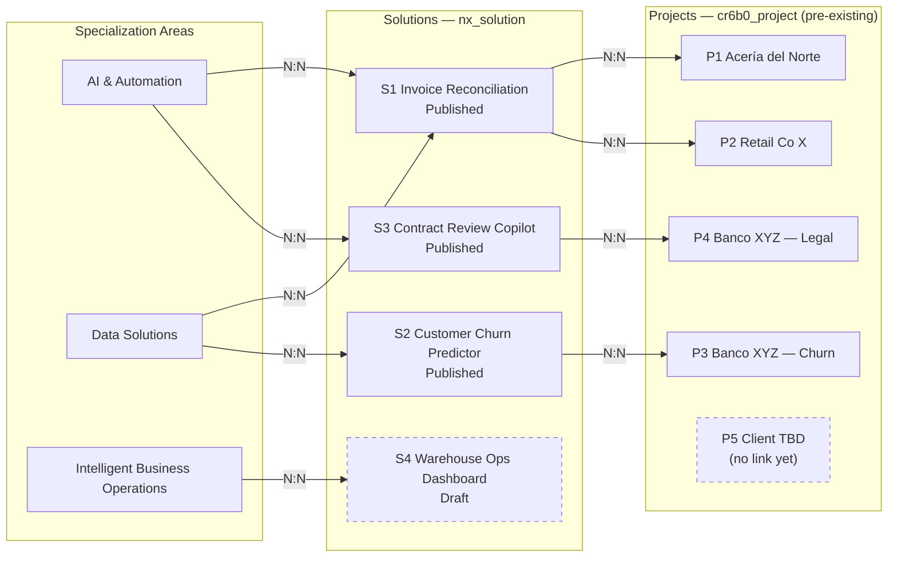
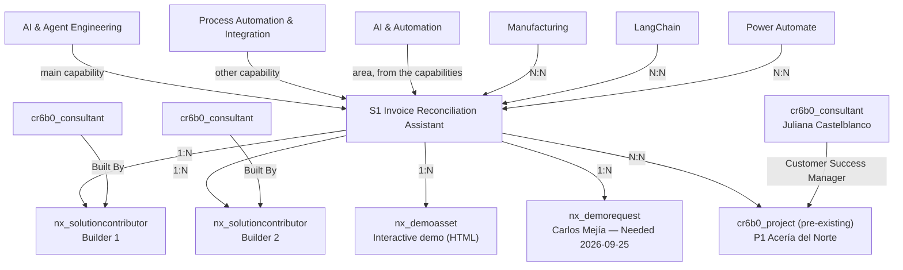

# Nextant Solution Library — Dataverse schema (v2)

**Status:** Authoritative · matches the live tables in Nextant Pulse (`PRISMA_Dev`) · **Last updated:** 2026-10-28

The data model behind PRISMA: what each Dataverse table holds, its columns with their live logical names, and the rules the plug-ins enforce on them. It replaces the [v1 schema](nextant-solution-library-dataverse-schema.md). Why each design was chosen lives in the ADRs; how it changed over time is in [History](#history) at the end.

**How to read the column tables**

| In the table | Means |
|---|---|
| **Required: Yes** | Always required |
| **Required: To submit** | A draft may leave it empty; submit and publication require it |
| 🔒 **Internal** | Never shown in present mode or the presentation download |
| 🛡️ **Plug-in only** | Only a PRISMA Custom API writes it; the app cannot change it directly |
| 🗄️ **Retired** | Still in Dataverse, but nothing reads or writes it |

Every table also has the system columns Dataverse adds on its own (`createdon`, `createdby`, `modifiedon`, `modifiedby`, `ownerid`, `statecode`, `statuscode`); they are not listed unless PRISMA uses them for something specific.

---

## At a glance

| Table | What it holds | Link to a solution |
|---|---|---|
| [`nx_solution`](#nx_solution) | The reusable solution: the unit a CSM finds and presents | — |
| [`nx_solutioncontributor`](#nx_solutioncontributor--builders-and-effort) | Who built it (credit only) | Many per solution |
| [`nx_demoasset`](#nx_demoasset--the-demo) | Videos, interactive demos and supporting files | Many per solution |
| [`nx_solutionimage`](#nx_solutionimage--the-gallery) | Screenshots | Many per solution |
| [`nx_solutionfavorite`](#nx_solutionfavorite--per-person-favorites) | Each person's saved solutions | Many per solution |
| [`nx_solutionsuggestion`](#nx_solutionsuggestion--private-suggestions) | Private suggestions from colleagues | Many per solution |
| [`nx_demorequest`](#nx_demorequest--the-live-demo-ask) | Requests for a live demo (not used by the app yet) | Many per solution |
| [`nx_capability`](#nx_capability) | Capability framework | One **main** per solution, plus one **other** |
| [`nx_specializationarea`](#nx_specializationarea) | AI & Automation · Data Solutions · Intelligent Business Operations | Several per solution, derived from its capabilities |
| [`nx_industry`](#nx_industry) | Industries | Several per solution |
| [`nx_technology`](#nx_technology) | Technologies (open list) | Several per solution |
| [`nx_clientrole`](#nx_clientrole) | Client roles the solution targets | Several per solution |
| [`cr6b0_project`](#cr6b0_project--the-evidence-already-exists-in-dataverse-fixed-columns) | Delivered projects (pre-existing table) | Several per solution |
| [`cr6b0_consultant`](#cr6b0_consultant--person-reference) | People (pre-existing directory table) | Through contributors, favorites, suggestions, owners |
| [`nx_uploadsession`](#private-upload-protocol-extension) | Private bookkeeping for file uploads | Server only |

"Several per solution" relationships are native Dataverse N:N relationships: Dataverse manages their intersect tables, so there are no hand-built junction tables.

## Visual schema

```mermaid
erDiagram
    nx_capability |o--o{ nx_solution : "main capability (lookup)"
    nx_capability }o--o{ nx_solution : "other capability (N:N)"
    nx_specializationarea }o--o{ nx_solution : "area (N:N)"
    nx_specializationarea |o--o{ nx_capability : "area of the capability"
    cr6b0_consultant |o--o{ nx_capability : "capability owner"
    nx_industry }o--o{ nx_solution : "N:N"
    nx_technology }o--o{ nx_solution : "N:N"
    nx_clientrole }o--o{ nx_solution : "target client role (N:N)"
    nx_solution }o--o{ cr6b0_project : "delivered on (N:N)"
    nx_solution ||--o{ nx_solutioncontributor : "credit"
    cr6b0_consultant ||--o{ nx_solutioncontributor : "built by"
    nx_solution ||--o{ nx_demoasset : "demos"
    nx_solution ||--o{ nx_solutionimage : "screenshots"
    nx_solution ||--o{ nx_solutionfavorite : "saved"
    cr6b0_consultant ||--o{ nx_solutionfavorite : "saved by"
    nx_solution ||--o{ nx_solutionsuggestion : "suggestions"
    cr6b0_consultant ||--o{ nx_solutionsuggestion : "suggested by"
    nx_solution ||--o{ nx_demorequest : "live-demo requests"
    cr6b0_consultant ||--o{ nx_demorequest : "requested by"
    cr6b0_consultant ||--o{ cr6b0_project : "customer success manager"

    nx_solution {
        guid nx_solutionid PK
        text nx_solutionname
        text nx_onelinesummary
        text nx_whatitdoes
        text nx_businessvalue
        lookup nx_capability FK
        text nx_clientcontext "internal"
        text nx_clientcontextredacted
        text nx_challenges "internal"
        text nx_lessonslearned "internal"
        choice nx_status
        choice nx_publicationstatus
        choice nx_reviewoutcome
        text nx_reviewcomments
        int nx_estimatedminimumhours "internal"
        choice nx_complexity "internal"
        lookup nx_librarianeditedby FK
        datetime nx_librarianeditedon
        boolean nx_librarianeditpending
        boolean nx_safetyacknowledged
        boolean nx_clientsafereviewed
        image nx_image
        date nx_dateadded
        text nx_librarynote
        text nx_searchkeywords
    }
    nx_solutioncontributor {
        guid nx_solutioncontributorid PK
        text nx_contributorname
        lookup nx_solution FK
        lookup nx_builtby FK
        choice nx_effortmode "always direct"
        int nx_sortorder "dev only, unused"
    }
    nx_demoasset {
        guid nx_demoassetid PK
        text nx_demoassetid1
        lookup nx_solution FK
        choice nx_assettype
        choice nx_assetpurpose
        file nx_filemedia
        text nx_externalurl
        text nx_embedhint
        boolean nx_allowsembedding
        int nx_sortorder
    }
    nx_solutionimage {
        guid nx_solutionimageid PK
        text nx_solutionimagename
        lookup nx_solution FK
        image nx_imagefile
        text nx_caption
        int nx_sortorder
    }
    nx_solutionfavorite {
        guid nx_solutionfavoriteid PK
        text nx_name
        lookup nx_solution FK
        lookup nx_user FK
    }
    nx_solutionsuggestion {
        guid nx_solutionsuggestionid PK
        text nx_name
        lookup nx_solution FK
        text nx_suggestion
        lookup nx_suggestedby FK
        datetime nx_addressedon
    }
    nx_demorequest {
        guid nx_demorequestid PK
        text nx_demorequestname
        lookup nx_solution FK
        lookup nx_requestedby FK
        text nx_clientopportunitycontext
        date nx_neededby
        choice nx_requeststatus
    }
    nx_capability {
        guid nx_capabilityid PK
        text nx_capabilityname
        int nx_sortordernumber
        lookup nx_specializationarea FK
        lookup nx_capabilityowner FK
    }
    nx_specializationarea {
        guid nx_specializationareaid PK
        text nx_specializationareaname
        text nx_description
        int nx_sortordernumber
    }
    nx_industry {
        guid nx_industryid PK
        text nx_industryname
        int nx_sortordernumber
    }
    nx_technology {
        guid nx_technologyid PK
        text nx_technologyname
    }
    nx_clientrole {
        guid nx_clientroleid PK
        text nx_clientrolename
    }
    cr6b0_project {
        guid cr6b0_projectid PK
        text cr6b0_projectidentifier UK
        text cr6b0_projecttitle
        lookup cr6b0_customersuccessmanager FK
        lookup cr6b0_deliverymanager FK
        lookup cr6b0_account FK
    }
    cr6b0_consultant {
        guid cr6b0_consultantid PK
        text cr6b0_consultantname UK
        text cr6b0_email
        text cr6b0_consultantlevel
        boolean cr6b0_employeestatus
    }
```

Retired columns (🗄️) are left out of the diagram. `cr6b0_project` and `cr6b0_consultant` are pre-existing tables with many more columns of their own (about ninety and thirty); the diagram and their sections show only an **excerpt**: identifiers, person links and what PRISMA reads.

---

## Main table

### `nx_solution`

The reusable solution — the unit of value a CSM finds and presents.

**What it is**

| Field | Logical name | Type | Required | Notes |
|---|---|---|---|---|
| Solution name *(primary name)* | `nx_solutionname` | Text (100) | Yes | Every save needs a real name; "Untitled solution" is not accepted |
| One-line summary | `nx_onelinesummary` | Text (200) | To submit | |
| What it does | `nx_whatitdoes` | Text (4000) | To submit | |
| Business value | `nx_businessvalue` | Text (4000) | To submit | |
| Status | `nx_status` | Choice | Yes | Idea / concept · Working prototype · Client demo · Live in production · Retired |
| Main capability | `nx_capability` | Lookup → `nx_capability` | To submit | Exactly one. Its area becomes the solution's area. The **other** capability is a separate N:N ([`nx_capability`](#nx_capability)) |
| Thumbnail | `nx_image` | Image | No | Not read by the connected app yet |
| Date added | `nx_dateadded` | Date | No | |
| Search keywords | `nx_searchkeywords` | Text | No | Extra search terms not in the visible text |

**Client and lessons**

| Field | Logical name | Type | Required | Notes |
|---|---|---|---|---|
| Client / context | `nx_clientcontext` | Text | No | 🔒 Internal. Free text |
| Client context (redacted) | `nx_clientcontextredacted` | Text | When client is set | The only client text present mode shows. Written by the contributor; names are never scrubbed automatically |
| Challenges | `nx_challenges` | Text area (2000) | No | 🔒 Internal. Blockers and difficulties met while building it. Not searched |
| Lessons learned | `nx_lessonslearned` | Text area (2000) | No | 🔒 Internal. Recommendations for the next team. Not searched |

**Effort** ([ADR-0014](../architecture/decisions/adr-0014-solution-effort-estimate-and-complexity.md))

| Field | Logical name | Type | Required | Notes |
|---|---|---|---|---|
| Estimated minimum hours | `nx_estimatedminimumhours` | Whole number | No | 🔒 Internal. Least time the whole solution took, including discovery. 0–100,000 (the plug-in checks it). Empty is not zero |
| Complexity | `nx_complexity` | Choice | To submit | 🔒 Internal. Easy · Medium · Hard |

**Review and publication** (rules in [Draft and transition contract](#draft-and-transition-contract))

| Field | Logical name | Type | Required | Notes |
|---|---|---|---|---|
| Publication status | `nx_publicationstatus` | Choice | Yes | 🛡️ Plug-in only. Draft · Pending review · Published · Retired. Starts as Draft |
| Review outcome | `nx_reviewoutcome` | Choice | Yes | 🛡️ Plug-in only. None · Changes requested · Approved. The latest decision; not proof of current approval. Not shown to CSMs |
| Review comments | `nx_reviewcomments` | Text (4000) | When sent back | 🛡️ Plug-in only. The latest feedback, or the retire reason. Not shown to CSMs |
| Safety acknowledged | `nx_safetyacknowledged` | Yes/No | Yes | The contributor confirms the content is authorized and anonymized. Must be renewed after edits |
| Client-safe reviewed | `nx_clientsafereviewed` | Yes/No | Yes | 🛡️ Plug-in only. Set only by librarian approval; cleared by material edits. Present mode needs this, Safety acknowledged and Published |
| Librarian edited by | `nx_librarianeditedby` | Lookup → `cr6b0_consultant` | No | 🛡️ Plug-in only. Column-secured: only librarians read it ([ADR-0013](../architecture/decisions/adr-0013-librarian-content-editing.md)) |
| Librarian edited on | `nx_librarianeditedon` | Date and time | No | 🛡️ Plug-in only. The owner sees this date |
| Librarian edit pending | `nx_librarianeditpending` | Yes/No | No | 🛡️ Plug-in only. True after a librarian change until it is explained |
| Library notes | `nx_librarynote` | Text | No | 🔒 Internal, column-secured. Librarian's own editorial notes, not feedback |
| Reviewed on | `nx_reviewedon` | Date and time | No | 🗄️ Created 2026-10-02, never used ([Q16](../delivery/decision-log.md)) |

Areas, industries, technologies, client roles, the other capability and projects are **not columns**: they attach through N:N relationships. Builders are rows in `nx_solutioncontributor`.

### Draft and transition contract

Drafts and submitted records use the same tables; there is no draft table, JSON payload or review-history table. `ownerid` decides ownership, not builder credit. Every change of state goes through the synchronous, authorized, version-checked operations in [ADR-0008](../architecture/decisions/adr-0008-controlled-submission-transitions.md); direct writes must not bypass them. Notifications are asynchronous and never authoritative.

**Saving a draft** needs only a real solution name (at most 100 characters). Everything else may be empty, and blank numbers or dates are stored as empty, never as zero. A new draft starts as Publication status Draft, Review outcome None and both safety flags false. Contributor rows need a person; empty picker rows are not saved.

**Submitting and approving** require: name, one-line summary, what it does, business value, a main capability (which gives at least one area), at least one contributor, a complexity, a fresh safety acknowledgment, the redacted client context when a client is set, and one to six screenshots. File uploads must finish first. App validation helps the user; the plug-ins are the real check.

| Operation | Who, and from which state | Result |
|---|---|---|
| Save draft | Contributor who can edit the record (new, Draft, Pending review or Published); Librarian | Draft; Client-safe reviewed false; latest review outcome and comments kept |
| Submit | Same | Pending review after full validation; Client-safe reviewed false |
| Return | Librarian, Pending review only | Draft; Changes requested; comments required (max 4000); both safety flags false |
| Approve | Librarian, Pending review only | Full validation plus client-safe confirmation; Published; Client-safe reviewed true; Approved; comments replaced or cleared |
| Request changes (published) | Librarian, Published only | Same as Return, and reader shares revoked |
| Librarian edit ([ADR-0013](../architecture/decisions/adr-0013-librarian-content-editing.md)) | Librarian, Pending review or Published | State, acknowledgment, shares and outcome unchanged; contributors untouched. A real change sets the three librarian-edit columns; on a Published record it also clears Client-safe reviewed (out of present mode until confirmed). While pending, Approve requires comments |
| Confirm edit | Librarian, Published with an unexplained edit | Approval checks; explanation (max 4000) replaces comments; Client-safe reviewed true; pending flag cleared; reader shares restored |
| Retire | Librarian, Published only | Retired; reason required (max 4000) replaces comments; Client-safe reviewed false; reader shares revoked |

The **Changes requested** queue is Publication status Draft and Review outcome Changes requested. A resubmitted record may still show Changes requested as its latest outcome but belongs in Pending review, and an edited, formerly approved record may keep Approved while being Draft. Only the publication and safety fields decide whether something is approved. Opening an editor read-only changes nothing.

Review comments hold only the latest decision; reviewer history would need a separate audit design (`modifiedby`/`modifiedon` change with every later edit). The mock PoC keeps its own browser copy of these fields and maps them the same way; it never writes Dataverse.

---

## Tables related to Solution

### `nx_solutioncontributor` — builders and effort

One row per person credited on a solution. Credit only: being listed grants no access, and the row's access follows its parent solution. The owner and the librarian manage the rows.

| Field | Logical name | Type | Required | Notes |
|---|---|---|---|---|
| Name *(primary name)* | `nx_contributorname` | Text | Yes | Generated "solution — person" label (100 characters); never used as identity |
| Solution | `nx_solution` | Lookup → `nx_solution` | Yes | |
| Built by | `nx_builtby` | Lookup → `cr6b0_consultant` | Yes | One person per row |
| Effort mode | `nx_effortmode` | Choice | Yes | Written as `direct` on every save; must stay. `calendar` is only on old rows |
| Sort order | `nx_sortorder` | Whole number | No | **In dev only, not used yet.** Created by the user 2026-10-28 to keep contributors in the order they were added; the plug-in change that writes and reads it is parked |
| Direct hours | `nx_directhours` | Decimal | No | 🗄️ Retired 2026-10-15: effort is now the solution's estimate and complexity |
| Start date | `nx_startdate` | Date | No | 🗄️ Retired 2026-10-08 |
| End date | `nx_enddate` | Date | No | 🗄️ Retired 2026-10-08 |

- **One row per person per solution:** alternate key `nx_solutioncontributorkey` (`nx_builtby` + `nx_solution`). Submit requires at least one contributor.
- **CSM:** nothing role-related is stored. A contributor whose directory level (`cr6b0_consultantlevel`) names customer success is shown as the solution's CSM and named as CSM in the presentation download; everyone else is a builder ([ADR-0007](../architecture/decisions/adr-0007-contributor-effort.md#csm-from-the-consultant-level)).
- 🔒 Present mode shows no contributor data at all: no names, levels, CSM or effort.

### `nx_solutionfavorite` — per-person favorites

Backs the heart, **Saved solutions** and the Top shelf. One row per person per saved solution, private to that person.

| Field | Logical name | Type | Required | Notes |
|---|---|---|---|---|
| Name *(primary name)* | `nx_name` | Text | No | Display label only |
| Solution | `nx_solution` | Lookup → `nx_solution` | Yes | The saved solution |
| User | `nx_user` | Lookup → `cr6b0_consultant` | Yes | The person who saved it. Despite the label it points at `cr6b0_consultant`, **not** `systemuser` |
| Saved on | `createdon` | System | — | |

- **One save per person:** alternate key `nx_solutionuser` (`nx_solution` + `nx_user`).
- **Who can see what:** the table is user-owned and roles get Read at User depth only, so each person sees only their own rows. Rows are created and deleted only by `nx_SetFavorite`, which takes the person from the sign-in (never from the app) and first checks the caller can read the solution.
- **Ranking:** `nx_GetTopFavorites` returns up to 10 published solutions, most saved first, with how many people saved each but never who. Shown outside present mode.
- **Deleting:** deleting a solution deletes its favorites (cascade); sharing does **not** cascade, so publishing a solution never exposes who saved it. Deleting a consultant only empties `nx_user`; readers ignore those rows.

### `nx_solutionsuggestion` — private suggestions

Colleagues suggest improvements to a published solution; only its owner, its contributors and the librarian read them ([ADR-0012](../architecture/decisions/adr-0012-private-solution-suggestions.md)). No role has privileges on the table: the plug-ins read and write it after checking the caller can read the solution.

| Field | Logical name | Type | Required | Notes |
|---|---|---|---|---|
| Name *(primary name)* | `nx_name` | Text (100) | Yes | Filled by the plug-in; not shown |
| Solution | `nx_solution` | Lookup → `nx_solution` | Yes | Deleting the solution deletes its suggestions; assigning does not move them |
| Suggestion | `nx_suggestion` | Text area (1000) | Yes | |
| Suggested by | `nx_suggestedby` | Lookup → `cr6b0_consultant` | Yes | Resolved from the sign-in; shown as the author's name |
| Addressed on | `nx_addressedon` | Date and time | No | 🛡️ Plug-in only. Empty while open; set when the owner marks it addressed |

The date shown is `createdon`. There is no status column.

### `nx_demoasset` — the demo

What a CSM opens: videos, interactive demos and supporting files. New video, HTML, PDF and PowerPoint uploads are stored in Azure Blob Storage through the plug-ins ([ADR-0010](../architecture/decisions/adr-0010-attachments-in-blob-through-plugins.md)); links and older files stay in Dataverse.

| Field | Logical name | Type | Required | Notes |
|---|---|---|---|---|
| Name *(primary name)* | `nx_demoassetid1` | Text | Yes | The title people see (1–100 characters, editable). Defaults to the file name |
| Solution | `nx_solution` | Lookup → `nx_solution` | Yes | |
| Asset type | `nx_assettype` | Choice | Yes | The format: HTML file · Video · One-pager / slide · Power BI · Desktop app or script · URL · Power Apps |
| Asset purpose | `nx_assetpurpose` | Choice | No | 🛡️ Plug-in only. What it is for: Demo video · Interactive demo · Supporting material ([ADR-0011](../architecture/decisions/adr-0011-asset-purpose.md)) |
| File | `nx_filemedia` | File | For uploads | File stored in Dataverse (older files and when Blob is off) |
| External URL | `nx_externalurl` | Text (URL) | For links | |
| Embed hint | `nx_embedhint` | Long text | No | Note shown in the viewer, e.g. "sign-in may stall in this frame" |
| Allows embedding | `nx_allowsembedding` | Yes/No | No | |
| Sort order | `nx_sortorder` | Whole number | No | |

### `nx_solutionimage` — the gallery

Screenshots. A submitted solution needs one to six; the thumbnail does not count.

| Field | Logical name | Type | Required | Notes |
|---|---|---|---|---|
| Name *(primary name)* | `nx_solutionimagename` | Text | Yes | Generated "solution — image n" |
| Solution | `nx_solution` | Lookup → `nx_solution` | Yes | |
| Image | `nx_imagefile` | Image | Yes | Stores full-size images |
| Caption | `nx_caption` | Text | No | Shown under the image |
| Sort order | `nx_sortorder` | Whole number | No | Gallery order |

### `nx_demorequest` — the live-demo ask

A request for a live demo of a solution. The table exists but **the app does not use it yet**.

| Field | Logical name | Type | Required | Notes |
|---|---|---|---|---|
| Name *(primary name)* | `nx_demorequestname` | Text | Yes | Generated "solution — requester" |
| Solution | `nx_solution` | Lookup → `nx_solution` | Yes | |
| Requested by | `nx_requestedby` | Lookup → `cr6b0_consultant` | Yes | |
| Client / opportunity context | `nx_clientopportunitycontext` | Long text | No | |
| Needed by | `nx_neededby` | Date | No | |
| Request status | `nx_requeststatus` | Choice | Yes | New · Acknowledged · Scheduled · Delivered · Declined |

### `cr6b0_project` — the evidence (already exists in Dataverse, fixed columns)

A pre-existing table of delivered projects. PRISMA never changes it, adds no columns and no lookups to or from it. **Excerpt** of its roughly ninety columns:

| Field | Logical name | Type | Notes |
|---|---|---|---|
| Project identifier *(primary name)* | `cr6b0_projectidentifier` | Text | Alternate key `cr6b0_projectidentifierkey` |
| Project title | `cr6b0_projecttitle` | Text | **What PRISMA shows**; "Untitled project (id)" when blank |
| Project description | `cr6b0_projectdescription` | Long text | Not read |
| Project type | `cr6b0_projecttype` | Choice | Not read |
| Current project status | `cr6b0_currentprojectstatus` | Choice | Not read |
| Start / end date | `cr6b0_projectstartdate`, `cr6b0_projectenddate` | Date | Not read |
| Customer success manager | `cr6b0_customersuccessmanager` | Lookup → `cr6b0_consultant` | Not read |
| Delivery manager | `cr6b0_deliverymanager` | Lookup → `systemuser` | Not read; belongs to the source system |
| Account | `cr6b0_account` | Lookup → `account` | Not read |

PRISMA reads only `cr6b0_projectid` and `cr6b0_projecttitle`. There is no column called "Project Owner".

### `Solution` ↔ `cr6b0_project` — linking Solutions to delivery evidence

A native N:N relationship: one solution links to several projects and vice versa — the reuse signal, the same solution delivered to more than one client. Shown internally as **Associated projects** on the solution page; hidden in present mode. A project linked to no solution simply has no row; that absence is the librarian's classification queue.

### Intake triage: not every legacy record gets linked to a Solution

Nextant's systems of record for delivered work (BPM Project Inventory, GitHub repos and others) stay independent; PRISMA does not replace them. A project is linked to a solution only if:

1. There is, or could easily be, a presentable asset — not just internal automation glue.
2. The same approach could be repeated for another client.
3. An external prospect would recognize the problem it solves.
4. It can be described without breaking confidentiality.

Internal tooling, one-off support for a single stakeholder and culture or operations apps are not linked.

---

## Reference tables

Shared lists every PRISMA role can read. Specialization areas, capabilities and industries are governed: only the librarian or an administrator adds values. Technologies are open: anyone adds one while submitting, and the librarian resolves look-alikes ([reference-data governance](reference-data-governance.md)).

### `nx_specializationarea`

| Field | Logical name | Type | Required | Notes |
|---|---|---|---|---|
| Specialization area *(primary name)* | `nx_specializationareaname` | Text | Yes | AI & Automation · Data Solutions · Intelligent Business Operations |
| Description | `nx_description` | Text | No | The note under each area in the library |
| Sort order | `nx_sortordernumber` | Whole number | No | |

A solution's areas are **derived** from its main and other capability: the plug-ins save one area per capability, main first, and ignore areas sent by the app. Relationship: `nx_Solution_nx_SpecializationArea_nx_SpecializationArea`.

### `nx_capability`

The organization's capability framework. Each capability belongs to one area and may have a Capability Owner.

| Field | Logical name | Type | Required | Notes |
|---|---|---|---|---|
| Capability *(primary name)* | `nx_capabilityname` | Text | Yes | List below |
| Sort order | `nx_sortordernumber` | Whole number | No | Order in the picker |
| Specialization area | `nx_specializationarea` | Lookup → `nx_specializationarea` | No | The area it belongs to; choosing the capability gives the solution this area. A capability without an area cannot be chosen |
| Capability owner | `nx_capabilityowner` | Lookup → `cr6b0_consultant` | No | Shown in the solution page and the review panel. A provisioned owner acts as librarian for solutions whose **main** capability is in the same area ([security model](../architecture/security-model.md#approved-librarian-provisioning-2026-10-26), [Q21](../delivery/decision-log.md)) |

How a solution uses it:

- **Main capability:** the lookup `nx_solution.nx_capability`, exactly one at submit.
- **Other capability:** the N:N `nx_Solution_nx_SecondaryCapability`, at most one, different from the main, and only once a main is chosen. It adds its area to the solution but grants no librarian authority. Written only through `nx_SaveDraftGraph`.

**Current values** (14 active; the first 13 in sort order as read back 2026-10-23, see [reference-data governance](reference-data-governance.md))

| Capability | Area | Capability owner |
|---|---|---|
| Analytics Consulting | Data Solutions | Lucia Bustillo |
| Governance & Security | Data Solutions | Gerson Salinas |
| Business Aplications Engineering *(typo in Dataverse)* | AI & Automation | Mauricio Cubillos |
| Data Modeling & Architecture | Data Solutions | Juan Pablo Sarmiento |
| AI-Enabled Data Solutions | Data Solutions | Antonio Alvarez |
| Data Engineering | Data Solutions | Jorge Isaias Ardila |
| Process Automation & Integration | AI & Automation | Andres Perez |
| AI & Agent Engineering | AI & Automation | Shashank Saxena |
| Responsible AI & Platform Governance | AI & Automation | Patricia Méndez |
| Program & Project Leadership | Intelligent Business Operations | Jessica Wilson |
| Operational Transformation | Intelligent Business Operations | Catalina Vasquez |
| Change Management & Adoption | Intelligent Business Operations | Mary Thomason |
| AI-Enabled Operations & Governance | Intelligent Business Operations | Valentina Velosa |
| Business Intelligence | Data Solutions | Juan Sebastian Uribe |

Business Intelligence was added 2026-10-28; its sort position is not recorded yet. AI Transformation was removed. Renaming a capability keeps every solution linked to it.

### `nx_industry`

| Field | Logical name | Type | Required | Notes |
|---|---|---|---|---|
| Industry *(primary name)* | `nx_industryname` | Text | Yes | E.g. Financial services, Manufacturing; "Cross-industry" for industry-agnostic solutions |
| Sort order | `nx_sortordernumber` | Whole number | No | |

Several per solution; at least one is expected and checked at review, not by the schema.

### `nx_technology`

| Field | Logical name | Type | Required | Notes |
|---|---|---|---|---|
| Technology *(primary name)* | `nx_technologyname` | Text | Yes | Open list: React, Power BI, LangChain… Approval waits until each possible duplicate is decided |

Several per solution.

### `nx_clientrole`

| Field | Logical name | Type | Required | Notes |
|---|---|---|---|---|
| Client role *(primary name)* | `nx_clientrolename` | Text | Yes | 14 roles: Chief of Staff, the five C-suite roles, Enterprise Architect, Solution Architect, Product Owner, Project Manager, Business Unit Leader, Operation Manager, IT Manager, Director, Other. An administrator adds roles in Dataverse |

Several per solution, or none. Client-safe: present mode shows and filters by them. Written only through `nx_SaveDraftGraph`.

### `cr6b0_consultant` — person reference

The pre-existing people directory. Every person link PRISMA owns points here, not at `systemuser`. **Excerpt** of its roughly thirty columns; PRISMA never writes it.

| Field | Logical name | Type | Notes |
|---|---|---|---|
| Consultant name *(primary name)* | `cr6b0_consultantname` | Text | Name in every person picker. Alternate key `cr6b0_consultantnamekey` |
| Email | `cr6b0_email` | Text | How a signed-in account is matched to its person |
| Employee status | `cr6b0_employeestatus` | Yes/No | The picker lists only active rows with this true |
| V-Active | `cr6b0_vactive` | Yes/No | Not the picker filter |
| Consultant level | `cr6b0_consultantlevel` | Text (100) | Shown read-only beside each contributor; marks the CSM. 🔒 Not in present mode |
| Is CSM / Is delivery manager | `cr6b0_iscsm`, `cr6b0_isdeliverymanager` | Yes/No | Not read; the CSM comes from the level |
| Specialization area | `cr6b0_specializationarea` | Lookup | Points at a **different** table outside PRISMA, not `nx_specializationarea` |

---

## Security model

| Role | `nx_solution` | Media and screenshots | Reference tables | `nx_demorequest` | Solution ↔ Project |
|---|---|---|---|---|---|
| Contributor | Create; read and edit own; read published | Same as the parent | Read; create technologies only | Read own | Create; read and edit own |
| CSM | Read published only | Read for published parents | Read | Create; read own | Read |
| Librarian | Full | Full | Full | Full | Full |

- **Unpublished solutions** stay invisible to CSMs at the platform level. Review fields and library notes have field permissions and are never part of what CSMs or present mode receive.
- **Contributors:** managed only by whoever can manage the parent solution; CSMs read them only for published solutions.
- **Favorites and suggestions:** see their sections; nobody, the librarian included, reads another person's favorites.
- **Media:** uploaded screenshots and files are owned by the Media Custodian team; finished files are shared read-only with the owner, and approval shares them with Published Readers. Removal happens through the plug-ins while Draft.
- **Ownership:** all business tables are user/team-owned; only `nx_uploadsession` is organization-owned.
- **Librarian scope (2026-10-26):** capability owners act as librarians for their area, with a global override for Luis; librarians read every area's queue but decide only in their own. Onboarding of the remaining owners and least-privilege acceptance are still open.

Full roles and profiles: [security model](../architecture/security-model.md). Present mode is not a security boundary for the PoC's bundled mock data.

---

## Live Dataverse reference

Exact names for code. Source: the `PRISMA_Dev` solution in Nextant Pulse (`ce09ad9b-57d1-e5df-9400-8ce973c86213`); the same names appear in `app/connected/.power/schemas/dataverse/` (regenerate with `pac solution export --name PRISMA_Dev`).

### Tables

| Logical name | Schema name | Entity set | Primary id | Primary name | Ownership |
|---|---|---|---|---|---|
| `nx_solution` | `nx_Solution` | `nx_solutions` | `nx_solutionid` | `nx_solutionname` | User |
| `nx_solutioncontributor` | `nx_SolutionContributor` | `nx_solutioncontributors` | `nx_solutioncontributorid` | `nx_contributorname` | User |
| `nx_demoasset` | `nx_DemoAsset` | `nx_demoassets` | `nx_demoassetid` | `nx_demoassetid1` | User |
| `nx_solutionimage` | `nx_solutionimage` | `nx_solutionimages` | `nx_solutionimageid` | `nx_solutionimagename` | User |
| `nx_demorequest` | `nx_DemoRequest` | `nx_demorequests` | `nx_demorequestid` | `nx_demorequestname` | User |
| `nx_solutionfavorite` | `nx_solutionfavorite` | `nx_solutionfavorites` | `nx_solutionfavoriteid` | `nx_name` | User |
| `nx_solutionsuggestion` | — | — | `nx_solutionsuggestionid` | `nx_name` | User |
| `nx_specializationarea` | `nx_SpecializationArea` | `nx_specializationareas` | `nx_specializationareaid` | `nx_specializationareaname` | User |
| `nx_capability` | `nx_Capability` | `nx_capabilities` | `nx_capabilityid` | `nx_capabilityname` | User |
| `nx_industry` | `nx_Industry` | `nx_industries` | `nx_industryid` | `nx_industryname` | User |
| `nx_technology` | `nx_Technology` | `nx_technologies` | `nx_technologyid` | `nx_technologyname` | User |
| `nx_clientrole` | `nx_ClientRole` | `nx_clientroles` | `nx_clientroleid` | `nx_clientrolename` | User |
| `cr6b0_consultant` | `cr6b0_Consultant` | `cr6b0_consultants` | `cr6b0_consultantid` | `cr6b0_consultantname` | User |
| `cr6b0_project` | `cr6b0_Project` | `cr6b0_projects` | `cr6b0_projectid` | `cr6b0_projectidentifier` | User |
| `nx_uploadsession` | `nx_UploadSession` | `nx_uploadsessions` | `nx_uploadsessionid` | `nx_name` | **Organization** |

Naming quirks to know, not fix: `nx_demoasset`'s primary name is `nx_demoassetid1`; Sort order is `nx_sortordernumber` on reference tables but `nx_sortorder` on `nx_demoasset`, `nx_solutionimage` and `nx_solutioncontributor`.

### Choice values

A write sends the integer, not the label. Unknown values must fail, never fall back to a default, and never derive a value from its position.

| Column | Scope | Values |
|---|---|---|
| `nx_solution.nx_status` | Global | 125060000 Live in production · 125060001 Idea / concept · 125060002 Client demo · 125060003 Retired · 125060004 Working prototype |
| `nx_solution.nx_publicationstatus` | Global | 125060000 Published · 125060001 Retired · 125060002 Pending review · 125060003 Draft |
| `nx_solution.nx_reviewoutcome` | Local | 125060000 None · 125060001 Changes requested · 125060002 Approved |
| `nx_solution.nx_complexity` | Local | 125060000 Easy · 125060001 Medium · 125060002 Hard (no default) |
| `nx_solutioncontributor.nx_effortmode` | Local | 125060000 direct · 125060001 calendar (old rows only). Labels are lowercase |
| `nx_demoasset.nx_assetpurpose` | Local | 125060000 Demo video · 125060001 Interactive demo · 125060002 Supporting material |
| `nx_demoasset.nx_assettype` | Local | 125060000 Self-contained HTML file · 125060001 Video walkthrough only · 125060002 Client-ready one-pager / slide · 125060003 Power BI · 125060004 Desktop app or script · **125060007** Hosted web app (URL; shown as "URL") · **125060008** Power Apps. 125060005 and 125060006 are unused |
| `nx_demorequest.nx_requeststatus` | Local | 125060000 New · 125060001 Acknowledged · 125060002 Scheduled · 125060003 Delivered · 125060004 Declined |

### Relationship schema names

N:N relationships, addressed by these exact names:

| Relationship | Between | Intersect entity |
|---|---|---|
| `nx_Solution_nx_SpecializationArea_nx_SpecializationArea` | `nx_solution` ↔ `nx_specializationarea` | `nx_Solution_nx_SpecializationArea` |
| `nx_Solution_nx_SecondaryCapability` | `nx_solution` ↔ `nx_capability` (other capability) | `nx_solution_nx_secondarycapability` |
| `nx_Solution_nx_Industry_nx_Industry` | `nx_solution` ↔ `nx_industry` | `nx_Solution_nx_Industry` |
| `nx_Solution_nx_Technology_nx_Technology` | `nx_solution` ↔ `nx_technology` | `nx_Solution_nx_Technology` |
| `nx_ClientRole_nx_Solution_nx_Solution` | `nx_clientrole` ↔ `nx_solution` (client role is Entity 1) | `nx_clientrole_nx_solution` |
| `nx_Solution_cr6b0_Project_cr6b0_Project` | `nx_solution` ↔ `cr6b0_project` | `nx_Solution_cr6b0_Project` |

`DraftGraphGuard` rejects direct Associate/Disassociate on the PRISMA relationships; they change only through `nx_SaveDraftGraph`.

Named 1:N relationships with non-default behavior:

| Relationship | Delete | Assign / share | Why |
|---|---|---|---|
| `nx_solutionfavorite_Solution_nx_solution` | Cascade | None | Favorites go with their solution; sharing must not expose them |
| `nx_solutionfavorite_User_cr6b0_consultant` | Remove link | None | Only one relationship can cascade; deleting a consultant must not be blocked |
| `nx_solutionsuggestion` → `nx_solution` | Cascade | None | A suggestion keeps its author as owner |
| `nx_capability_SpecializationArea_nx_specializationarea` | Default | Default | Capability's area |
| `nx_capability_CapabilityOwner_cr6b0_consultant` | Default | Default | Capability owner |

### Alternate keys

| Key | Table | Columns |
|---|---|---|
| `nx_solutioncontributorkey` | `nx_solutioncontributor` | `nx_builtby` + `nx_solution` |
| `nx_solutionuser` (schema `nx_SolutionUser`) | `nx_solutionfavorite` | `nx_solution` + `nx_user` |
| `cr6b0_consultantnamekey` | `cr6b0_consultant` | `cr6b0_consultantname` |
| `cr6b0_projectidentifierkey` | `cr6b0_project` | `cr6b0_projectidentifier` |

---

## Private upload protocol extension

Server-only bookkeeping for resumable uploads ([ADR-0009](../architecture/decisions/adr-0009-mediated-media-and-publication-access.md)). `nx_uploadsession` is organization-owned, reachable only by the plug-ins and never a data source of the app. Its id columns are GUID strings for this protocol, not business relationships.

| Column | Type | Purpose |
|---|---|---|
| `nx_uploadsessionid` | GUID | Session id |
| `nx_name` | Text (100) | Generated label |
| `nx_parentid`, `nx_callerid`, `nx_targetid` | Text (36) each | Solution, uploading user and media row |
| `nx_kind` | Text (20) | `image` or `attachment` |
| `nx_filename`, `nx_mime` | Text (200 / 120) | Original file name and type |
| `nx_token` | Long text (10000) | Private continuation token; cleared when finished, never returned |
| `nx_sha256` | Text (64) | Digest of the exact bytes, needed to resume |
| `nx_storage` | Text (20) | `blob` for Blob uploads ([ADR-0010](../architecture/decisions/adr-0010-attachments-in-blob-through-plugins.md)); empty means Dataverse |
| `nx_blobname` | Text (100) | Server-generated blob path; never sent to or accepted from the app |
| `nx_blobetag` | Text (100) | Committed blob version; reads and deletes check it |
| `nx_hashstate` | Text (100) | SHA-256 progress while uploading |
| `nx_bytes`, `nx_received`, `nx_nextblock` | Whole number (0–524,288,000) | Declared size, bytes received, next block |
| `nx_expires` | Date and time (UTC) | Two-hour deadline for unfinished uploads |
| `nx_complete` | Yes/No | Finished, validated and shared read-only |

Environment variables: `nx_MediaBlobContainerUrl` (the container URL) and `nx_MediaBlobUploads` (yes/no) decide where new attachment uploads go. Production values are in the [deployment runbook](../architecture/technical-architecture.md#production-deployment-runbook).

---

## Retired columns and known gaps

**Still in Dataverse, not used**

| Column | Since | To remove it |
|---|---|---|
| `nx_solutioncontributor.nx_directhours` | 2026-10-15 | Needs a separately approved deletion |
| `nx_solutioncontributor.nx_startdate`, `nx_enddate` | 2026-10-08 | Optional: remove them from the unused "Information" form, publish, then delete ([Q20](../delivery/decision-log.md)) |
| `nx_solution.nx_reviewedon` | Created 2026-10-02, never used | Delete, or reuse if review dates return ([Q16](../delivery/decision-log.md)) |
| `nx_solutioncontributor.nx_sortorder` | Created in dev 2026-10-28 | Not retired: waiting for its plug-in change |

Not read by the connected app yet: `nx_solution.nx_image` and the whole `nx_demorequest` table. Rows saved under the old effort models are test data and are not backfilled.

**Accepted differences from Dataverse**

- Text lengths in Dataverse are mostly 850 (text) and 4000 (long text); the lengths above are the design limits, which the app and plug-ins apply where they matter (name 100, summary 200), not the column metadata.
- Required levels in Dataverse can differ from the Required column here (e.g. `nx_capability` is Application Required, which only Dataverse forms enforce). The plug-ins are the real rule.
- The app's generated models still list deleted columns (`nx_role`, `nx_allocationpercent`, `nx_solution.nx_clientrole`) and lack newer ones. Harmless, since the app writes through the plug-ins; regenerate on the next connected-app change.

**Gaps against the target contract:** owners must withdraw a published solution to Draft before editing it; separate thumbnail and caption editing and deleting a solution are not built.

## Still open

- Who links a solution to a project: the librarian during triage, or the solution's owner?
- Client roles: required at submit?
- Favorites: should the ranking also count views or demo requests? Who cleans up favorites left without a person?

Resolved: areas per solution now come from the main and other capability (at most two, the main capability's area first).

---

## Example: one Solution, several Projects, via the native N:N relationship

Each solution has one main capability and one or more areas, and can link to **several** projects directly through the N:N relationship.

S1 links to **both** P1 and P2: the same solution delivered twice. S4 (Draft) and P5 (not linked yet) are dashed.

## Example: everything hanging off one Solution

The solution row is the hub: the tags say *what it is*, What it does and Business value say *what it achieves*, `nx_demoasset` is *what a CSM can show*, and the link to `cr6b0_project` is *proof it was delivered*.

---

## History

One line per change to the model; details in the linked ADRs and the [change log](../delivery/change-log.md).

- **2026-09-21** — Capability became a single lookup; business calendar tables removed; every person lookup moved from `systemuser` to `cr6b0_consultant`; `nx_project` renamed `cr6b0_project`; Solution ↔ Project became a native N:N (junction `nx_solutionproject` dropped); Review outcome and Review comments added. Industry and Technology stayed N:N; `nx_projectevidence` dropped.
- **2026-09-22** — Private upload sessions with SHA-256 resume (`nx_uploadsession`, ADR-0009).
- **2026-09-23** — Specialization area became an N:N (lookup deleted, no backfill); `nx_solutionfavorite` created; client role choice and contributor role added (both later removed).
- **2026-09-28 / 10-01** — Favorites APIs, Top ranking and save counts.
- **2026-10-02** — `nx_reviewedon` created (unused); request changes on published solutions; retire reason required.
- **2026-10-06** — `nx_assetpurpose` (ADR-0011).
- **2026-10-08** — Effort as minimum hours per person; CSM from the directory level; `nx_role` and `nx_allocationpercent` deleted; start/end dates retired; one-line summary limited to 200; What it does and Business value required (ADR-0007).
- **2026-10-13** — `nx_challenges` and `nx_lessonslearned`; `nx_solutionsuggestion` (ADR-0012); capabilities renamed to the framework, with area and owner.
- **2026-10-14** — `nx_solutionsuggestion.nx_addressedon`.
- **2026-10-15** — Librarian editing columns (ADR-0013); solution-level `nx_estimatedminimumhours` and `nx_complexity`, per-person hours retired (ADR-0014).
- **2026-10-21** — `nx_clientrole` table and its N:N; the old `nx_solution.nx_clientrole` choice deleted.
- **2026-10-23** — Capability list read back: 13 active, four in Intelligent Business Operations, AI Transformation removed, every capability with an owner.
- **2026-10-23 / 26** — Other capability (`nx_Solution_nx_SecondaryCapability`), saved by the plug-ins from 2026-10-26; areas derived from capabilities; capability owners scope librarians; uploaded files get display names.
- **2026-10-28** — `nx_solutioncontributor.nx_sortorder` created in dev (not used yet); Business Intelligence capability (Data Solutions, owner Juan Sebastian Uribe).
